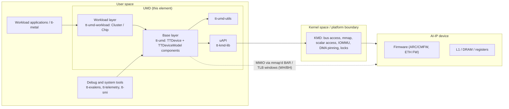
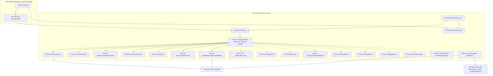
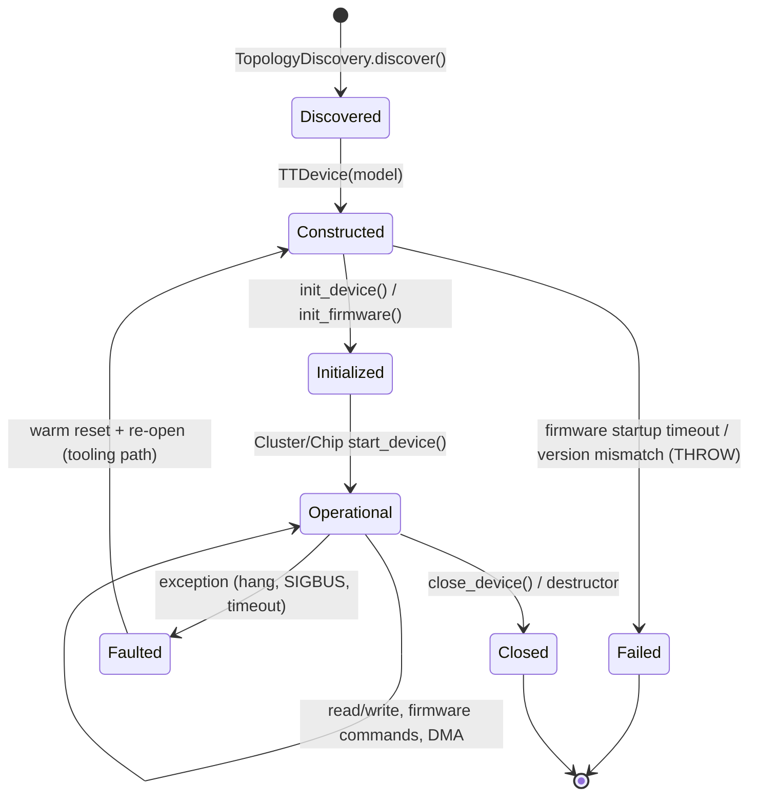
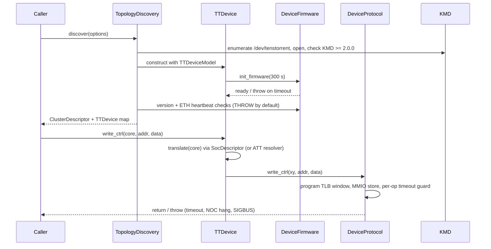

# Software Architectural Design — UMD (User Mode Driver)

ISO 26262-6:2018, software architectural design, component ("spoke") level. Template revision 0.2, which takes in the semiconductor, SEooC and IP guidance from ISO 26262-11:2018.

> **Status: DRAFT 0.1, not baselined.** Content marked *(provisional)* or *TBD* is waiting on inputs listed in Section 17. Architectural content describes the **target base-layer design** (*UMD Base API Components 1.0.0* and *TTDevice Reference Example 1.0.0*). Each element is mapped to the code at the draft baseline commit, and the differences are recorded as open items. Assumption: the frozen safety baseline will be the first release that implements the target design (OI-02).
>
> **Clause numbering:** this document keeps the template's clause references (e.g. "Clause 8", "8.5.3(a)"). In ISO 26262-6:2018, software architectural design is **Clause 7** (requirements 7.4.x, work products 7.5.x, verification 7.4.14 / Table 6), and Clause 8 is unit design and implementation. Correct together with the template (OI-16).

---

## Document Control

| Field | Value |
| :---- | :---- |
| Project / Item name | UMD — Tenstorrent User Mode Driver |
| Document ID | TBD — per project doc-numbering scheme |
| Version | 0.1 Draft |
| ASIL(s) covered by this SW element | **Target: highest achievable ASIL per element; allocation TBD** by the customer Technical Safety Concept. Interim per-element classification in Section 7. |
| Author(s) | TBD |
| Reviewer(s) — independence per ISO 26262-8 Cl.6.4.6 | TBD |
| Approver | TBD |
| Baseline / SW version this document describes | Draft baseline: `80e9cd853be8d29e2a228a8de61ac586f8dbabcd` (main, 2026-10-29; last tag `v0.9.15`). Safety baseline to be frozen — OI-02. |
| Related SW Safety Requirements Spec ID | Not available — provisional ATSRs in Section 14 |
| Related Safety Plan ID | TBD |
| Parent hub document | AI-IP Software Architecture Overview — expected; ID TBD (OI-03) |

## Component Identity

| Field | Value |
| :---- | :---- |
| Repository URL | https://github.com/tenstorrent/tt-umd |
| Safety baseline (commit hash / tag) | Not frozen. Draft analysis at `80e9cd85` (OI-02). |
| License | Apache-2.0 |
| Primary language(s) / split | C++17, about 58 kLOC in three libraries: base `tt-umd` (`src` 31k + `api` 14k), `tt-umd-workload` 11k, `tt-umd-utils` 2k. C: `tt-kmd-lib` about 2k. C++ nanobind Python bindings about 4k. Tests about 25k (C++/Python). |
| Upstream release cadence | Roughly weekly to biweekly minor tags (`v0.9.12` 2026-09-28, `v0.9.14` 2026-10-15, `v0.9.15` 2026-10-27). The API is pre-1.0 and still being restructured. |
| Single accountable supplier? (Y/N) | **Y** for UMD itself (Tenstorrent Inc.). Several runtime dependencies are open source with no single accountable supplier (Section 6). |

---

## 1. Introduction

### 1.1 Purpose

This document defines the software architectural design of UMD per ISO 26262-6:2018 (software architectural design). It is the basis for software unit design and implementation and for software integration testing of UMD.

### 1.2 Scope

**In scope:** the UMD library as shipped (`libtt-umd`). It is built from:

- **Base layer** (`tt-umd`, CMake target `tt-umd-base`): `TTDevice` and the components assembled by `TTDeviceModel`. It owns the transport, device initialisation, topology discovery and the device-access primitives.
- **Workload layer** (`tt-umd-workload`): `Cluster` and `Chip` (Local, Remote, Mock). It builds multi-chip workload services on top of the base layer. It links the base layer and produces the shipped `libtt-umd`.
- **Common utilities** (`tt-umd-utils`): robust cross-process mutex, error types, the operation timeout guard, polling helpers.
- **uAPI layer** (`tt-kmd-lib`): the boundary to the kernel-mode driver (KMD) through ioctl and mmap.

**Conditionally in scope (decision OI-04):** the Python bindings (`nanobind/`), if the safety-relevant application calls UMD through Python.

**Out of scope, covered by separate documents:**

- The KMD (`tt-kmd`), the Linux kernel, IOMMU and bus drivers. These are the lower boundary.
- Device firmware (ARC/CMFW, ETH FW) and AI-IP hardware.
- Consumers above UMD: tt-metal, tt-fabric, tt-exalens, tt-telemetry, tt-smi, tt-triage.
- Build-time-only components: simulation (TTSim/RTL), software emulation (tt-emule), Tracy profiling, tests, tools and examples. They are excluded **only if** they are not built into the deployed configuration (A3).

### 1.3 Definitions and Abbreviations

| Term | Meaning |
| :---- | :---- |
| AI-IP | Tenstorrent AI accelerator IP / device (Wormhole, Blackhole, Quasar) |
| ARC / CMFW | On-device management controller and its chip-management firmware |
| ATT | Address Translation Table — decodes a flat address into destination tile + offset (Quasar) |
| ATSR | Assumed Technical Safety Requirement (provisional traceability anchor) |
| AoU | Assumption of Use |
| BAR | PCIe Base Address Register (MMIO aperture) |
| DIA | Development Interface Agreement |
| FFI | Freedom From Interference |
| Grendel | Device model for Quasar-architecture devices |
| IOVA | I/O Virtual Address (device-visible address of host memory) |
| KMD | Kernel-Mode Driver (`tt-kmd`) |
| NOC | Network-on-Chip |
| SEooC | Safety Element out of Context |
| SM | Safety Mechanism |
| TLB (device) | Host-programmable window mapping a BAR region onto a NOC address |
| uAPI | User-space API boundary to the KMD (ioctl / mmap) |
| WC / UC | Write-Combining / Uncacheable host memory mapping |

Standard ISO 26262 abbreviations (ASIL, HARA, SM, SSR, TSR, HSI, LOI, WCET) are used as defined in ISO 26262-1.

---

## 2. Reference Documents

| Ref | Document | Version |
| :---- | :---- | :---- |
| [R1] | ISO 26262-6:2018 | - |
| [R2] | ISO 26262-11:2018 (informative) | - |
| [R3] | Item Definition | Not available — SEooC, see Section 4 |
| [R4] | HARA | Not available — SEooC |
| [R5] | Functional Safety Concept | Not available |
| [R6] | Technical Safety Concept / HSI | Not yet available — see Section 14 |
| [R7] | Software Safety Requirements Specification | Not available — ATSRs in Section 14 |
| [R8] | Software Safety Plan | TBD |
| [R9] | Coding Guideline | None adopted yet (OI-09). Current practice: `.clang-tidy`, `.clang-format`, `README.clang-tidy.md` |
| [R10] | DIA(s) | N/A |
| [R11] | UMD Base API Components | 1.0.0 |
| [R12] | TTDevice Reference Example | 1.0.0 |
| [R13] | UMD architecture diagrams (layering, context, user/kernel boundary) | Draft set, 2026-10 |
| [R14] | UMD locking backends (`RobustMutex`, `KmdMutex`) — source documentation | at baseline |

---

## 3. Software Item / Component Definition

UMD is a user-space C++ library. It discovers Tenstorrent AI-IP devices, opens them through the KMD, and gives upper-layer software access to device memory, registers, firmware commands, telemetry and device-visible host memory. It runs entirely in the caller's process and threads. It has no scheduler or tasks of its own.

**Target deployment (A1, provisional):** UMD in Linux user space on an embedded ARM (aarch64) host. Whether the host is a separate ARM CPU or a CPU complex on the AI-IP is not decided, and the customer safety target is not confirmed (OI-01). Development and CI today run on x86-64 Linux hosts with PCIe-attached Wormhole/Blackhole cards. Quasar-architecture devices are opened through the Grendel model (SW-203), which uses KMD scalar accesses instead of mapped windows. aarch64 builds are produced (`manylinux-aarch64` packaging), but there is no aarch64 hardware evidence (Section 15.2).

**Software element name:** UMD (`libtt-umd`): base layer + workload layer + common utilities + uAPI

**ASIL / classification:** Target ASIL TBD per element (Section 7). Interim: elements on the safety data and control path are "ASIL candidate"; diagnostics, telemetry and tooling elements are QM.

**Traceability anchor:** ATSR-001 … ATSR-006 *(provisional)*, Section 14.

---

## 4. SEooC Positioning and Development Approach

UMD has no named customer item yet, so it is developed as an **SEooC** with documented Assumptions of Use. It was **not** developed under an ISO 26262 process. For the existing code base, confidence has to be built by **evaluation of the element** (ISO 26262-8 Cl.13), or by re-development of the elements that receive an ASIL allocation. "Proven in use" (ISO 26262-8 Cl.14) is not claimed: field data are not collected in a qualifying form, and the code changes weekly.

| Element / sub-component | Approach | Rationale |
| :---- | :---- | :---- |
| Base layer core (`TTDevice`, `DeviceProtocol`, `DeviceFirmware`, `IoWindow`, `SystemMemoryAllocator`, `ArchitectureImplementation`, ATT `EndpointResolver`) | SEooC + evaluation of element (Cl.13) | On the safety data/control path; existing code, no ISO 26262 history |
| Client-provided base components (`TopologyDiscovery`, `SocArchDescriptor`, `SocDescriptor`) | SEooC; the reference implementation is provided, and the **integrator owns the final implementation** | [R11] marks them "Client-Provided — implement the .cpp for your architecture". Correctness becomes an AoU on the integrator. |
| Optional base components (`HangDetector`, `RiscReset`, `FirmwareTelemetryReader`, `DmaInterface`, `PcieInterface`, `JtagInterface`, `RemoteInterface`) | SEooC; may be stubbed (excluded) per deployment | [R11] allows stubs. Inclusion depends on transport and architecture (OI-01). |
| Workload layer (`tt-umd-workload`: `Cluster`, `Chip`) | SEooC + evaluation of element | Needed only if the safety application uses the multi-chip workload API |
| Common utilities (`tt-umd-utils`) | SEooC + evaluation of element | Used by base and workload layers; small, self-contained |
| uAPI (`tt-kmd-lib`) | SEooC + evaluation of element | Thin C wrapper over KMD ioctls; KMD itself is out of scope |
| Python bindings | Conditional (OI-04) | In scope only if on the safety execution path |

**Assumptions of Use (provisional):**

| ID | Assumption of Use |
| :---- | :---- |
| AoU-01 | The integrator handles every exception raised by UMD and decides the safe-state reaction. UMD does not drive the item into a safe state by itself. |
| AoU-02 | The integrator applies end-to-end protection (e.g. CRC + sequence counter) to safety-relevant data exchanged with the device. UMD does not check data integrity on the host↔device path. |
| AoU-03 | The integrator supervises timing with an external watchdog. UMD calls are blocking and have no WCET bound (Section 8). |
| AoU-04 | The platform provides IOMMU-based isolation of device DMA, or the integrator accepts the reduced isolation of the hugepage/no-IOMMU mode. |
| AoU-05 | Only one safety application owns a given device. Other processes (tools, telemetry) either do not open it, or are covered by the FFI argument in Section 11. |
| AoU-06 | The KMD version is ≥ 2.0.0 (enforced at open), and the firmware bundle version is in UMD's supported range (enforced at discovery when the default `THROW` policy is kept). |
| AoU-07 | `TopologyDiscoveryOptions` keeps the strict defaults (`THROW`) in the safety configuration. Setting any action to `IGNORE` is outside the safety configuration. |
| AoU-08 | The integrator verifies client-provided components (`TopologyDiscovery`, `SocArchDescriptor`, `SocDescriptor`) for the target architecture. |
| AoU-09 | Environment variables that change UMD behaviour (`TT_VISIBLE_DEVICES`, `TT_BACKEND_CPUSET_ALLOCATOR_*`, `TT_UMD_MEMCPY_TIMING`, `TT_SIMULATOR_*`) are fixed or unset in the deployed configuration. |

---

## 5. Assumptions, Dependencies and Constraints

| # | Assumption / Constraint | Safety relevance / Verification method |
| :---- | :---- | :---- |
| A1 | Host is embedded ARM (aarch64) Linux, user space (OI-01) | Determines transport, device model (WH/BH vs Grendel), memory model and FFI argument. Verify on target HW (Section 15.2). |
| A2 | Toolchain: GCC ≥ 11 or Clang ≥ 13, CMake ≥ 3.16 (FILE_SET install needs 3.23), C++17 | Tool qualification per ISO 26262-8 Cl.11 not done (OI-10) |
| A3 | Deployed safety configuration = production `libtt-umd` (base + workload + utils + `tt-kmd-lib`) with `TT_UMD_BUILD_SIMULATION`, `TT_UMD_BUILD_EMULE`, `TT_UMD_ENABLE_TRACY`, `TT_UMD_BUILD_TESTS`, `TT_UMD_BUILD_EXAMPLES`, `TT_UMD_BUILD_TOOLS` OFF. `TT_UMD_BUILD_PYTHON` per OI-04. JTAG transport is always compiled in at this baseline (no build option). | Defines the dependency register (Section 6). Verify with a build-configuration audit. |
| A4 | KMD ≥ 2.0.0 (`KMD_MINIMUM_VERSION`) is installed and provides ioctl, mmap, scalar access, DMA pinning, IOMMU mapping and resource locks | Checked at device open; KMD qualification is out of scope |
| A5 | Either IOMMU is enabled, or 1 GiB hugepages are mounted at `/dev/hugepages-1G` | Affects DMA isolation (Section 10/11) |
| A6 | All processes sharing a device see the same `/dev/shm` (RobustMutex) or the same `/dev/tenstorrent/<N>` (KmdMutex) | Precondition for the cross-process lock FFI argument |
| A7 | Device firmware is a supported version and behaves according to its interface specification | Firmware is out of scope. Version checked at discovery (AoU-06). |
| A8 | Hardware supports the transaction ordering promised by the chosen `HostMemoryCaching` (WC: relaxed; UC: strict) | `IoWindow` gives minimal ordering guarantees at the interface level [R11] |

---

## 6. Third-Party and Black-Box Component Register

Runtime dependencies of the production library (A3):

| Component / dependency | Form | Qualification path | Base-failure-rate / DC owner | Single accountable supplier? |
| :---- | :---- | :---- | :---- | :---- |
| `tt-umd-utils` (in repo) | Source, C++ | Evaluation (Cl.13), together with UMD | This team | Y — Tenstorrent |
| `tt-kmd-lib` (in repo) | Source, C | Evaluation (Cl.13), together with UMD | This team | Y — Tenstorrent |
| `tt-kmd` (KMD) | Kernel module, separate repo | Separate safety document; DIA with KMD owner (OI-03) | KMD team | Y — Tenstorrent |
| `tt-logger` 1.1.8 | Source, header use | Evaluation (Cl.13) | Unresolved | Y — Tenstorrent |
| `spdlog` 1.15.2 (header-only) | Open source | Unqualified black box; evaluation or replacement | Unresolved | **N** |
| `fmt` 11.1.4 (header-only, **public** dependency of base and utils) | Open source | Unqualified black box; evaluation or replacement | Unresolved | **N** |
| `yaml-cpp` 0.8.0 + patches (`2f86d13`) | Open source | Unqualified. Used for SoC/cluster descriptor parsing — evaluate, or exclude by using arch-enum descriptors only | Unresolved | **N** |
| `asio` 1.30.2 (header-only) | Open source | Unqualified black box | Unresolved | **N** |
| `hwloc` (system library) | Open source, system package | Unqualified. Used for NUMA/CPU affinity — evaluate or exclude | Unresolved | **N** |
| `librt`, glibc, libstdc++ | System libraries | Treated as part of the platform; covered by the OS/platform safety case | Platform owner | N — distribution |
| JTAG library (loaded with `dlopen` at runtime) | Binary, Tenstorrent-provided | Only if JTAG transport is used; DIA. Code path always compiled in (A3). | Unresolved | Y — Tenstorrent |
| `nanobind` 2.10.2 + CPython | Open source | Only if Python is in scope (OI-04) | Unresolved | **N** |

Build-, test- and tool-only (not in the runtime register when A3 holds): `googletest` 1.13.0, `nanobench` 4.6.0, `cxxopts` 3.2.1 + patches, `nng` 1.8.0, `flatbuffers` 24.3.25, `libuv` 1.51.0, `tracy` 0.13.3-tt.0, `tt-emule` (`acf8473`).

---

## 7. Static Architecture — Hierarchical Decomposition (Clause 8.5.3(a))

ASIL column: **C** = ASIL candidate (on the safety data/control path; final ASIL from TSC), **QM** = not on the safety path, **Cond** = depends on OI-01/OI-04.

Solid arrows are required components; dashed arrows are optional components [R11].

| Element ID | Name | Purpose | ASIL | Parent element | Code at draft baseline |
| :---- | :---- | :---- | :---- | :---- | :---- |
| SW-000 | UMD | User-space driver for AI-IP devices | C | top-level | repo root |
| SW-100 | Workload layer | Multi-chip services for workload software | C (Cond) | SW-000 | `tt-umd-workload/` |
| SW-101 | Cluster | Owns all chips; cluster-wide I/O, barriers, start/stop | C (Cond) | SW-100 | `tt-umd-workload/src/cluster.cpp` |
| SW-102 | Chip (LocalChip, RemoteChip) | Per-chip workload operations, sysmem management, TLB allocation | C (Cond) | SW-100 | `tt-umd-workload/src/chip/` |
| SW-200 | Base layer | Single-device front end and hardware-facing components | C | SW-000 | `tt-umd/` (target `tt-umd-base`) |
| SW-201 | TTDevice | Front end and lifetime manager for one device; translates coordinates and delegates to components | C | SW-200 | `tt-umd/src/tt_device/tt_device.cpp` |
| SW-202 | TTDeviceModel | Composition root, one concrete model per transport × architecture (Wormhole, Blackhole, Grendel, simulation) | C | SW-200 | `tt-umd/src/tt_device_model/` |
| SW-203 | GrendelTTDeviceModel | Quasar model: KMD scalar accesses, no BAR, DMA, hang detection or firmware component | Cond (OI-01) | SW-202 | `grendel_tt_device_model.cpp` |
| SW-210 | DeviceProtocol | Transport-level data (throughput) and control (ordered) read/write, multicast | C | SW-202 | `tt-umd/src/tt_device/protocol/` |
| SW-211 | DeviceFirmware | Firmware init, command dispatch (ARC messages), DRAM/ETH training, power/clock, chip identity | C | SW-202 | `tt-umd/src/tt_device/firmware/`, `tt-umd/src/arc/` |
| SW-212 | ArchitectureImplementation | Per-architecture constants and register encodings | C | SW-202 | `tt-umd/src/arch/` |
| SW-213 | SocArchDescriptor | Static, tapeout-fixed chip floorplan | C (client-provided) | SW-202 | `tt-umd/src/soc_arch_descriptor.cpp` |
| SW-214 | IoWindow | Host-mapped, reconfigurable window into device address space (TLB-backed on WH/BH; scalar-access-backed on Grendel) | C | SW-202 | `tt-umd/src/io_window/`, `tt-umd/src/pcie/silicon_tlb_window.cpp` |
| SW-215 | FirmwareInfoProvider | Firmware-version-agnostic metadata and telemetry | QM (C for version/identity queries) | SW-202 | `tt-umd/src/firmware/` |
| SW-216 | SystemMemoryAllocator / Buffer | Pinned, device-visible host memory (IOVA, optional NOC binding) | C | SW-202 | `tt-umd/src/chip_helpers/`, `hugepage.cpp` |
| SW-217 | ATT EndpointResolver | Folds a core coordinate into a flat address for architectures whose NOC carries no coordinate (Quasar) | Cond (OI-01) | SW-202 | `tt-umd/src/coordinates/att/` |
| SW-220 | HangDetector | Bus and NOC liveness probe (all-ones read signature) | C (diagnostic) | SW-202 | `tt-umd/src/tt_device/hang_detection/` |
| SW-221 | FirmwareTelemetryReader | Raw telemetry reads by tag | QM | SW-202 | `tt-umd/src/arc/*telemetry_reader*` |
| SW-222 | DmaInterface | Bounce-buffer and zero-copy DMA | Cond | SW-202 | `tt-umd/src/tt_device/protocol/pcie_dma/` |
| SW-223 | PcieInterface | BAR register access, NUMA node | Cond | SW-202 | `tt-umd/src/pcie/` |
| SW-224 | JtagInterface | MMIO via JTAG | QM (debug transport) | SW-202 | `tt-umd/src/jtag/` |
| SW-225 | RemoteInterface | Ethernet-tunnelled access to remote chips, non-MMIO flush | Cond | SW-202 | `tt-umd/src/tt_device/remote_communication*.cpp` |
| SW-226 | RiscReset | Soft-reset control of on-core RISC processors | C | SW-202 | `tt-umd/src/tt_device/` |
| SW-230 | TopologyDiscovery | Enumerate local devices, walk Ethernet links, check firmware compatibility, build ClusterDescriptor | C (client-provided) | SW-200 | `tt-umd/src/topology/` |
| SW-231 | SocDescriptor / CoordinateManager | Per-chip descriptor; harvesting-aware coordinate translation | C (client-provided) | SW-200 | `tt-umd/src/soc_descriptor.cpp`, `tt-umd/src/coordinates/` |
| SW-232 | ClusterDescriptor | Topology graph of chips and Ethernet links | C (Cond) | SW-200 | `tt-umd/src/cluster_descriptor.cpp` |
| SW-240 | LockManager / KmdMutex | Cross-process serialisation of ARC messages, remote ARC, non-MMIO, barriers, ETH map creation, chip ownership, DMA | C | SW-200 | `tt-umd/src/utils/lock_manager.cpp`, `kmd_mutex.cpp` |
| SW-250 | Warm reset | Device reset and recovery | QM (tooling) unless used for recovery in the safety concept | SW-200 | `tt-umd/src/warm_reset*.cpp` |
| SW-300 | uAPI (`tt-kmd-lib`) | C wrapper over KMD ioctls (query, pin, map, lock) | C | SW-000 | `tt-kmd-lib/` |
| SW-400 | Python bindings | Python access to UMD | Cond (OI-04) | SW-000 | `nanobind/` |
| SW-500 | Common utilities (`tt-umd-utils`) | `RobustMutex`, error types (`SigbusError` etc.), `OpTimeoutGuard`, polling, SemVer | C | SW-000 | `tt-umd-utils/` |

---

## 8. Dynamic Architecture — Behaviour (Clause 8.5.3(b))

**Scheduling model reference:** UMD has no tasks, threads or priorities of its own on the production path. Every API call runs synchronously on the caller's thread and blocks until it completes, times out or throws. One exception: warm reset spawns worker threads (SW-250, QM). Cross-process serialisation goes through SW-240. The caller owns the scheduling model (AoU-03).

**Timing budget / WCET analysis reference:** None. No WCET analysis exists, and most operations have no bounded execution time. Configured timeouts (`tt-umd/api/tt-umd/utils/timeouts.hpp`) bound some waits, but they are sized for bring-up, not safety reaction:

| Timeout | Default |
| :---- | :---- |
| Per-op MMIO budget (`MMIO_OP_TIMEOUT`, runtime-configurable, 0 disables) | 2 ms |
| ETH heartbeat check | 50 ms |
| ARC message | 1 s |
| Non-MMIO (remote) read/write | 5 s |
| DMA transfer | 10 s |
| ARC/firmware startup | 300 s |
| DRAM training | 300 s |
| ETH training | 900 s |

KmdMutex polls once per millisecond with no upper bound on wait time.

**Mode / state-machine reference (incl. safe state definition):** No safe state is defined inside UMD. On error UMD raises a C++ exception (`std::runtime_error` and derived types such as `SigbusError`; about 320 throw sites plus about 230 `UMD_ASSERT` in the base layer), and the caller chooses the reaction (AoU-01). Device lifecycle states:

**Representative sequence: device bring-up and a control-path write (WH/BH, PCIe)**

On Grendel (SW-203) the protocol step is a KMD scalar access with no TLB window and no per-op timeout guard. Firmware init and hang checks are absent.

---

## 9. Interfaces (Clause 8.5.3(c))

Interface IDs are local to this document until the hub registry exists (OI-03).

| Interface ID | From | To | Data / Protocol | ASIL (from/to) |
| :---- | :---- | :---- | :---- | :---- |
| IF-001 | Workload applications / tt-metal | SW-100 Workload layer | C++ API: Cluster/Chip read/write, barriers, start/stop, sysmem | TBD / C |
| IF-002 | Debug & system tools | SW-200 Base layer | C++ API: TTDevice, telemetry, reset | QM / C — **ASIL mismatch, see Section 11** |
| IF-003 | SW-100 | SW-201 TTDevice | Internal C++ API [R12] | C / C |
| IF-010 | SW-201 | SW-210 DeviceProtocol | `read/write_data`, `read/write_ctrl`, `write_to_core_range`; synchronous, throws on error | C / C |
| IF-011 | SW-201 | SW-211 DeviceFirmware | `init_firmware`, `send_device_command` (code, args, timeout → exit code + values), training waits, power/clock | C / C |
| IF-012 | SW-201 | SW-214 IoWindow | Mapped window: `read/write32/16`, block, aligned; `configure` retargets the window | C / C |
| IF-013 | SW-201 | SW-216 SystemMemoryAllocator | `allocate_buffer`, `map_user_buffer` → buffer with VA, IOVA, optional NOC address | C / C |
| IF-014 | SW-201 | SW-217, SW-220..226 optional components | Nullable pointers; caller must handle `nullptr` / `nullopt` | C / C or QM |
| IF-015 | SW-230 TopologyDiscovery | SW-201 | Construction + `init_device`; `TopologyDiscoveryOptions` error policy | C / C |
| IF-020 | SW-210, SW-216, SW-240 | SW-300 uAPI | C calls → ioctl (device info, pin/unpin, map, lock, scalar access), mmap of BARs | C / C |
| IF-021 | SW-200, SW-100 | SW-500 tt-umd-utils | C++ API: mutexes, error types, timeout guard | C / C |
| IF-030 | SW-300 | KMD | Linux ioctl / mmap ABI on `/dev/tenstorrent/<N>` | C / out of scope |
| IF-031 | SW-210, SW-214 | AI-IP device | MMIO loads/stores through mmap'd BAR + TLB windows (WH/BH), or KMD scalar access (Grendel); ordering per WC/UC mapping | C / out of scope |
| IF-032 | SW-211 | Device firmware (ARC/CMFW) | Mailbox / message queue: command code + args, polled response | C / out of scope |
| IF-033 | SW-225 | Remote chips via local chip ETH firmware | Command queues in ETH core L1, routed over Ethernet | C / out of scope |
| IF-034 | AI-IP device | SW-216 host memory | Device DMA / NOC reads and writes to pinned host buffers through IOVA | out of scope / C |
| IF-040 | SW-240, SW-500 | Other UMD processes | `/dev/shm` robust pthread mutex, or KMD resource lock | C / C or QM |
| IF-050 | Environment | SW-000 | Environment variables (AoU-09); YAML descriptor files | QM / C |

---

## 10. Data and Memory Architecture

- **Device memory access (WH/BH):** device L1, DRAM and registers are reached through a limited number of TLB windows that map a BAR region onto a NOC address. A window is reconfigured before each access outside its current range. Window state is shared per device, which is why reconfiguration goes through SW-210/SW-214.
- **Device memory access (Grendel):** every access is a KMD scalar access. The ATT resolver (SW-217) turns core + offset into a flat address. No host mapping of device memory exists.
- **Host memory visible to the device (SW-216):**
  - **With IOMMU:** buffers are pinned and mapped by the KMD, so the device sees an IOVA and can reach only mapped pages.
  - **Without IOMMU:** buffers come from 1 GiB hugepages and the IOVA is the physical address. Nothing on the host side limits which physical memory the device can access.
  
  `map_user_buffer` requires an IOMMU.
- **Host memory protection:** UMD state lives in ordinary process memory, protected only by the OS process boundary (MMU). UMD itself does not partition memory.
- **Shared structures:** lock state lives in `/dev/shm` (RobustMutex) or in the KMD (KmdMutex). The remote-command queues for Ethernet tunnelling live in device L1 and are shared by every process that uses the same local chip.
- **Data integrity:** UMD adds no CRC, ECC or redundancy to data on the host↔device path, and does no read-back verification. The only implicit check is the all-ones hang signature (SW-220, not on Grendel). Integrity is the integrator's responsibility (AoU-02). Device-side ECC, where present, is a hardware property outside this element.
- **Dynamic memory:** UMD uses heap allocation (`new`, `std::make_unique/shared`, STL containers) throughout, including after initialisation. There is no static-allocation mode.

---

## 11. Freedom from Interference / Coexistence (ISO 26262-9, Clause 6; ISO 26262-11, 5.4.2.2)

The main coexistence case is a safety application (ASIL candidate) and QM tools (tt-smi, tt-exalens, tt-telemetry) running at the same time against the same device (IF-002).

| Interference category | Shared resource / elements involved | Interference argument or mechanism | Example mitigation pattern (ISO 26262-11) |
| :---- | :---- | :---- | :---- |
| Memory — private regions | Host process memory of each UMD user | Separated by the OS process boundary (MMU). No argument exists for UMD users within one process: a QM component in the same process can corrupt UMD state. | Exclusive-access safety mechanism; access supervision |
| Memory — shared regions | Device L1/DRAM/registers; BAR/TLB windows; `/dev/shm` lock files; pinned host buffers | **No mechanism in UMD.** Any process with access to `/dev/tenstorrent/<N>` can write anywhere in device memory (by mapping BARs on WH/BH, or through scalar access on Grendel). Host-buffer isolation from device DMA depends on the IOMMU (AoU-04). Needs a platform measure: device access permissions, single-owner policy (AoU-05), IOMMU. | MPU/MMU-based memory encapsulation; un-sharing cores |
| Time and execution | Device locks (SW-240/SW-500); TLB windows; ARC mailbox; ETH command queues; host CPU | Cross-process locks serialise ARC messages, non-MMIO, barriers and DMA [R14]. RobustMutex recovers from owner death (`EOWNERDEAD`); KmdMutex is released when the fd closes. **No bound on lock-hold time**, so a QM process can delay the safety application without limit. | Timing supervision unit; time monitoring mechanism (external watchdog, AoU-03) |
| Exchange of information | IF-031/032/033/034 data and commands | No end-to-end protection in UMD (Section 10). Firmware responses are checked only for exit code and timeout. | Robust end-to-end protection, e.g. CRC + sequence counter (AoU-02) |

No hypervisor or microkernel partitioning is assumed. If the deployment adds one (OI-01), its dependent-failure analysis has to be referenced here.

---

## 12. Safety Mechanisms (Clause 7.4.7 / 8.5.3(e))

**No qualified safety mechanisms exist in UMD.** The table lists existing *diagnostic* features that are candidates for qualification. Their diagnostic coverage has not been assessed, and each one reacts only by throwing an exception to the caller. The last column shows which of them exist for the Grendel model (SW-203), since that may be the automotive target (OI-01).

| SM ID | Fault detected | Detection method | Diagnostic coverage | Reaction / safe state | Grendel |
| :---- | :---- | :---- | :---- | :---- | :---- |
| SM-C01 (candidate) | MMIO transfer stalled / NOC hang | Per-op timeout guard (`OpTimeoutGuard`, default 2 ms), with a NOC hang probe used to veto false alarms | Not assessed | Exception to caller | No |
| SM-C02 (candidate) | Host bus link down / device unreachable | All-ones read signature, confirmed by re-reading a known register over BAR (SW-220) | Not assessed; only triggers after a suspicious read | Exception (`HangAction::THROW`) or bool | No |
| SM-C03 (candidate) | Stale MMIO mapping after device reset / bus drop (SIGBUS) | SIGBUS handler with `siglongjmp`, converted to `SigbusError` when `use_safe_api` is set | Not assessed; `siglongjmp` across C++ frames needs separate analysis | Exception to caller | N/A (no mapping) |
| SM-C04 (candidate) | Incompatible / mismatched firmware | Version checks at discovery (CMFW, ETH FW, routing config) under `THROW` policy | Covers configuration faults only, at start-up | Discovery fails | No (no firmware component) |
| SM-C05 (candidate) | ETH firmware crashed on a link | ETH heartbeat check at discovery (`ETH_HEARTBEAT_TIMEOUT` 50 ms) | Start-up only | Discovery fails (`THROW`) | No |
| SM-C06 (candidate) | Incompatible KMD | `KMD_MINIMUM_VERSION` check at device open | Start-up only | Exception | Yes |
| SM-C07 (candidate) | Firmware not responding to commands | ARC message timeout (1 s) and exit-code check | Not assessed | Exception / error code | No |
| SM-C08 (candidate) | Concurrent conflicting access from multiple processes | Cross-process locks (SW-240/SW-500) with dead-owner recovery | Not a detection mechanism; prevents some conflicts | — | Partly (TBD) |

**Debug / diagnostic tooling, not safety mechanisms:** telemetry (SW-215/SW-221), JTAG access (SW-224), warm reset (SW-250), logging.

---

## 13. Coding Guideline Conformance (Clause 8.4.3)

- **Coding guideline:** none adopted (OI-09). MISRA C++:2023 or AUTOSAR C++14 have not been assessed. Expected large deviation classes:
  - exceptions as the error-reporting mechanism
  - dynamic memory after initialisation
  - `dlopen` (JTAG)
  - `siglongjmp` in the SIGBUS handler
  - runtime YAML parsing
  - templates and STL throughout
  - environment-variable-driven behaviour
- **Static analysis in use:**
  - clang-tidy, enabled in the build by default (`TT_UMD_ENABLE_CLANG_TIDY=ON`); broad check set with documented exclusions in `.clang-tidy`
  - CodeChecker (Clang Static Analyzer) in CI (`code-analysis.yaml`)
  - pre-commit hooks: clang-format, gersemi, black, yamllint, copyright and JSON-schema checks
  - `-Werror` by default
- **Tool qualification:** none (OI-10).
- **Deviation count:** not tracked (no guideline baseline).

---

## 14. Traceability (Clause 6 / 8.5.4)

No TSC or HSI is available, so the upward links point to provisional ATSRs. Each ATSR is logged in Section 17 (OI-05) and gets re-pointed when the TSC becomes available.

| ATSR | Assumed Technical Safety Requirement *(provisional)* |
| :---- | :---- |
| ATSR-001 | UMD shall transfer data between host and device without undetected corruption, **or** shall provide the means for the integrator to detect corruption (AoU-02). |
| ATSR-002 | UMD shall detect loss of communication with the device (bus/NOC hang, stale mapping, firmware not responding) and report it to the caller within a configurable time. |
| ATSR-003 | UMD shall report every detected error to the caller. Silent continuation after a detected fault is not allowed in the safety configuration. |
| ATSR-004 | UMD shall refuse to operate a device with an unsupported KMD or firmware version, or with an inconsistent topology. |
| ATSR-005 | UMD shall serialise access to shared device resources (firmware mailbox, remote-command queues, barriers, DMA engine) across processes. |
| ATSR-006 | UMD shall address the intended device core (correct coordinate translation, accounting for harvesting and ATT address folding). |

| SW Safety Requirement ID | Traces to | Architectural element(s) implementing it | Verification reference |
| :---- | :---- | :---- | :---- |
| SSR-001 (TBD) | ATSR-001 *(provisional)* | SW-210, SW-214, SW-216 | TBD — no E2E test exists |
| SSR-002 (TBD) | ATSR-002 *(provisional)* | SW-220, SM-C01, SM-C02, SM-C03, SM-C07 | Existing hang/timeout tests; coverage TBD. Not met on Grendel (Section 12). |
| SSR-003 (TBD) | ATSR-003 *(provisional)* | SW-201, SW-230 (`THROW` policy) | TBD |
| SSR-004 (TBD) | ATSR-004 *(provisional)* | SW-230, SM-C04, SM-C05, SM-C06 | Existing discovery tests |
| SSR-005 (TBD) | ATSR-005 *(provisional)* | SW-240, SW-500 | Existing lock tests (incl. `tt-umd-utils/tests/test_robust_mutex.cpp`) |
| SSR-006 (TBD) | ATSR-006 *(provisional)* | SW-231, SW-217, SW-201 `translate()` | Coordinate unit tests |

---

## 15. Verification of the Software Architectural Design (Clause 9)

| Method | Applied? (per ASIL) | Result / findings | Status |
| :---- | :---- | :---- | :---- |
| Walkthrough | N — planned for draft 0.2 | — | open |
| Inspection | Partial — informal review of [R12] reference implementation | Findings F-01…F-06 below | open |
| Control-flow analysis | N | — | open |
| Data-flow analysis | N | — | open |

**Preliminary inspection findings on the target design [R12]** (also open items; to be re-checked against the code at baseline):

| ID | Finding |
| :---- | :---- |
| F-01 | `firmware_telemetry_reader_` and `firmware_info_provider_` are not initialised until `init_device()`. Calling their getters earlier reads an uninitialised pointer. |
| F-02 | `get_clock_freq()` dereferences `firmware_info_provider_` without a null check, unlike the neighbouring getters. |
| F-03 | Some failure paths are unimplemented: the multicast fallback in `write_to_core_range`, the broadcast overload, and the zero-copy DMA paths ("throw" placeholder comments). A failure there returns silently, which violates ATSR-003. |
| F-04 | `set_sigbus_safe_handler` is empty in the reference implementation. |
| F-05 | Documented contracts differ from the code: `send_device_command` says it "acquires the device lock" but the code takes none; `set_power_state` says it is a "no-op for remote devices" but there is no remote check; `wait_for_non_mmio_flush` ignores its `noc` argument. |
| F-06 | Default timeouts (Section 8) are too long to support any safety reaction-time argument. |

### 15.1 Pre-Silicon / Host Verification Evidence

| Evidence | Environment | Coverage / result | Reference |
| :---- | :---- | :---- | :---- |
| Unit / API tests (gtest) on mock and software-emulated chips | Host build, x86-64 | Pass in CI; structural coverage **not measured** (OI-11) | `tests/`, `tt-umd-workload/tests/`, `tt-umd-utils/tests/` |
| TTSim simulation tests | TTSim simulator, in-process | Pass in CI; coverage not measured | `run-ttsim-tests.yml` |
| TTSim-in-VM tests: real `tt-kmd` bound to simulated chips, UMD takes its silicon path | QEMU VM, x86-64 | Pass in CI; coverage not measured | `run-ttsim-qemu-tests.yml` |
| Sanitizer builds (ASan + LSan + UBSan, TSan) | Host build | Run in CI build matrix | `cmake/sanitizers.cmake`, `build-tests.yml` |
| Static analysis (clang-tidy, CodeChecker) | Host build | Findings tracked in CI, not baselined | `code-analysis.yaml` |
| aarch64 build | manylinux-aarch64 container | Build only, no execution | `release.yml`, `.github/manylinux-aarch64.Dockerfile` |

### 15.2 Post-Silicon / Target Hardware Verification Evidence

| Evidence | Target hardware | Coverage / result | Reference |
| :---- | :---- | :---- | :---- |
| Functional test suite on silicon | Wormhole n150, n300, n300 LLMBox, Galaxy 6U; Blackhole p100a, p150b, P300, Galaxy 6U, QuietBox — with and without vIOMMU; x86-64 hosts | Pass in CI; coverage not measured | `build-and-run-all-tests.yml` |
| Destructive tests (reset, recovery) | Wormhole / Blackhole CI runners | Pass in CI | `run-destructive-tests.yml` |
| Embedded ARM target | **None** | — | OI-01 |
| Quasar / Grendel silicon | **None** | — | OI-01 |
| Fault-injection testing (ISO 26262-11, 4.8) | **None** | — | OI-12 |

---

## 16. Confirmation Measures

No confirmation review has been carried out. Item-level (vehicle) confirmation reviews are expected to be tailored out for this SEooC per ISO 26262-11:2018, 4.11. The final tailoring has to match the hub document's policy (OI-03).

---

## 17. Open Items / Known Limitations

| # | Open item | Owner | Target date | Status |
| :---- | :---- | :---- | :---- | :---- |
| OI-01 | Target platform not decided: external ARM host vs CPU on the AI-IP; device architecture (WH/BH vs Quasar/Grendel); customer safety target. Drives A1, the optional components in scope, the diagnostics available (Section 12) and Section 15.2. | TBD | TBD | open |
| OI-02 | Freeze the safety baseline. The target base-layer design [R11/R12] is only partly in code (e.g. `TTDeviceModel` has extra `RiscReset`, `EndpointResolver` and `PCIDevice` accessors; the reference `TTDevice` differs). The repo restructuring into base / workload / utils libraries is in progress. Baseline = first release implementing the target design. | TBD | TBD | open |
| OI-03 | Align with the hub AI-IP SW Architecture Overview: interface IDs, tailoring policy, KMD DIA. | TBD | TBD | open |
| OI-04 | Decide whether Python bindings are in the safety execution path. | TBD | TBD | open |
| OI-05 | ATSR-001…006 are provisional. Re-point them to TSRs and re-verify when the TSC/HSI is available. Trigger: TSC access granted. | TBD | TBD | open |
| OI-06 | No data-integrity mechanism on the host↔device path (ATSR-001). Decide between a UMD mechanism and AoU-02. | TBD | TBD | open |
| OI-07 | No safe state, WCET or bounded-time error reaction; timeouts sized for bring-up (F-06). | TBD | TBD | open |
| OI-08 | No FFI for shared device memory or lock-hold time between safety and QM processes (Section 11). | TBD | TBD | open |
| OI-09 | No coding guideline adopted; MISRA C++:2023 gap analysis needed. | TBD | TBD | open |
| OI-10 | No tool qualification (compiler, clang-tidy, CodeChecker, CMake/CPM). | TBD | TBD | open |
| OI-11 | Structural coverage not measured. | TBD | TBD | open |
| OI-12 | No fault-injection testing. | TBD | TBD | open |
| OI-13 | Open-source runtime dependencies with no accountable supplier (`fmt`, `spdlog`, `yaml-cpp`, `asio`, `hwloc`). Evaluate, replace or remove from the safety configuration. | TBD | TBD | open |
| OI-14 | Inspection findings F-01…F-05 on the reference design; re-check against the baseline code. | TBD | TBD | open |
| OI-15 | `siglongjmp`-based SIGBUS recovery (SM-C03) needs a dedicated analysis of C++ object lifetime and lock state. | TBD | TBD | open |
| OI-16 | Template clause numbering: software architectural design is ISO 26262-6:2018 Clause 7, not Clause 8. Correct in the template and in this document. | Template owner | TBD | open |
| OI-17 | The Grendel model has no hang detection, per-op timeout or firmware component, so ATSR-002 has no implementing mechanism on Quasar. | TBD | TBD | open |
| OI-18 | JTAG transport and its `dlopen` path are always compiled in (no build option at baseline); decide whether to make it excludable from the safety configuration. | TBD | TBD | open |

---

## Appendix A — Glossary

See Section 1.3.

## Appendix B — Change Impact Analysis Log

| Revision | Triggering change | Affected elements | Re-verification |
| :---- | :---- | :---- | :---- |
| 0.1 | Initial draft at `80e9cd85` | All | — |

## Appendix C — Verification Review Checklist

To be completed at review per the template (C.1–C.4). Not started.
