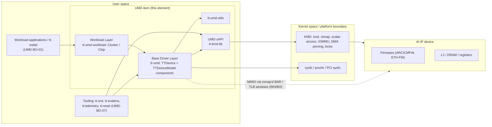
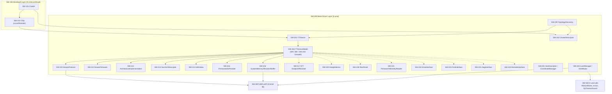
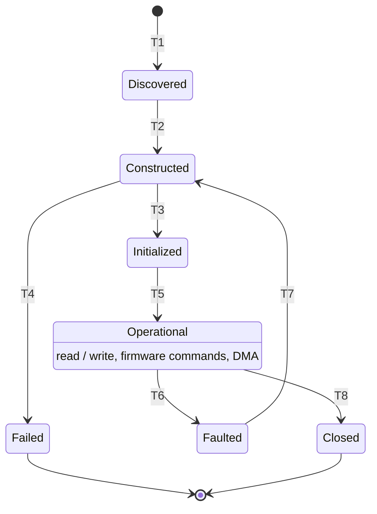
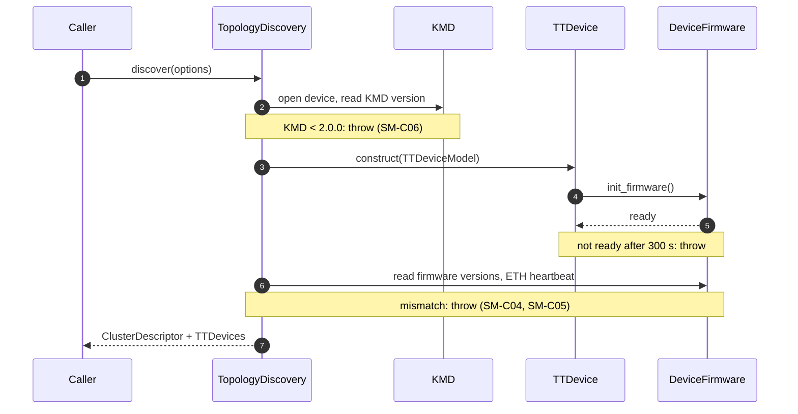
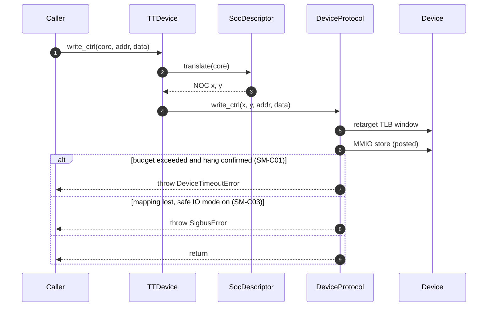

# Software Architectural Design — UMD (User Mode Driver)

ISO 26262-6:2018, software architectural design, component ("spoke") level. Template revision 0.2, which takes in the semiconductor, SEooC and IP guidance from ISO 26262-11:2018.

> **Status: DRAFT 0.2, not baselined.** Content marked *(provisional)* or *TBD* is waiting on inputs listed in Section 17. Architectural content describes the **target Base Driver Layer design** (*UMD Base API Components 1.0.0* and *TTDevice Reference Example 1.0.0*). Each element is mapped to the code at the draft baseline commit, and the differences are recorded as open items. Assumption: the frozen safety baseline will be the first release that implements the target design (ARCH-OI-02).
>
> **Upstream input:** *Item Definition – UMD* v0.2 (draft, 2026-10-23) [R3]. It is not final. IDs taken from it (`UMD-SG`, `UMD-AS`, `UMD-OM`, `UMD-FN`, `UMD-FL`, `UMD-HLR`, `UMD-OI`, …) are re-checked whenever it changes. Open items of this document are prefixed `ARCH-OI-` to keep them apart from the Item Definition's `UMD-OI-`.
>
> **Clause numbering:** the template cites ISO 26262-6 "Clause 8" and "8.5.3(x)". In ISO 26262-6:2018, software architectural design is **Clause 7** (requirements 7.4.1–7.4.14, work products 7.5.1–7.5.4, verification methods Table 4). This document cites the 2018 clauses. The template correction is ARCH-OI-16.

---

## Document Control

| Field | Value |
| :---- | :---- |
| Project / Item name | UMD — Tenstorrent User Mode Driver |
| Document ID | TBD — proposed `UMD-SW-ARCH`, in line with `UMD-ITEM-DEF` (Item Definition reference `UMD-REF-02`) |
| Version | 0.2 Draft |
| ASIL(s) covered by this SW element | **ASIL B(D) for all of UMD** (decision 2026-10-30). UMD carries the ASIL B part of the assumed ASIL D safety goals `UMD-SG-001`…`005` [R3 §4.1]. No coexistence of lower-ASIL elements is claimed (Section 7). |
| Author(s) | TBD |
| Reviewer(s) — independence per ISO 26262-8 Cl.6.4.6 | TBD |
| Approver | TBD |
| Baseline / SW version this document describes | Draft baseline: `80e9cd853be8d29e2a228a8de61ac586f8dbabcd` (main, 2026-10-29; last tag `v0.9.15`). Item Definition v0.2 was written against `v0.9.14`. Safety baseline to be frozen — ARCH-OI-02 (`UMD-OI-06`). |
| Related SW Safety Requirements Spec ID | Not available. Provisional anchors: `UMD-HLR-001`…`022` and `UMD-CON-001` [R3 §15] (Section 14, ARCH-OI-05) |
| Related Safety Plan ID | TBD |
| Parent hub document | AI-IP Software Architecture Overview — expected; ID TBD (ARCH-OI-03) |

## Component Identity

| Field | Value |
| :---- | :---- |
| Repository URL | https://github.com/tenstorrent/tt-umd |
| Safety baseline (commit hash / tag) | Not frozen. Draft analysis at `80e9cd85` (ARCH-OI-02). |
| License | Apache-2.0 |
| Primary language(s) / split | C++17, about 58 kLOC in three libraries: base `tt-umd` (`src` 31k + `api` 14k), `tt-umd-workload` 11k, `tt-umd-utils` 2k. C: `tt-kmd-lib` about 2k. C++ nanobind Python bindings about 4k. Tests about 25k (C++/Python). |
| Upstream release cadence | Roughly weekly to biweekly minor tags (`v0.9.12` 2026-09-28, `v0.9.14` 2026-10-15, `v0.9.15` 2026-10-27). The API is pre-1.0 and still being restructured. |
| Single accountable supplier? (Y/N) | **Y** for UMD itself (Tenstorrent Inc.). Several runtime dependencies are open source with no single accountable supplier (Section 6). |

---

## 1. Introduction

### 1.1 Purpose

This document defines the software architectural design of UMD per ISO 26262-6:2018 Clause 7 (work product 7.5.1). It is the basis for software unit design and implementation (Clause 8) and for software integration and verification (Clause 10) of UMD.

### 1.2 Scope

**In scope:** the UMD item as defined in the Item Definition [R3 §5.1], shipped as `libtt-umd`:

- **Workload Layer** (`UMD-BI-01`, `tt-umd-workload`): `Cluster`, `Chip` (`LocalChip`, `RemoteChip`), and the execution policy for workload consumers. It links the Base Driver Layer and produces the shipped `libtt-umd`.
- **Base Driver Layer** (`UMD-BI-02`, `tt-umd`, CMake target `tt-umd-base`): `TTDevice` and the components assembled by `TTDeviceModel`. It owns the transports, device initialisation, topology discovery and the device-access primitives. It includes UMD's reference implementation of the client-provided components.
- **UMD uAPI** (`UMD-BI-03`, `tt-kmd-lib`): the boundary to the kernel-mode driver (KMD) through ioctl.
- **Common utilities** (`tt-umd-utils`): robust cross-process mutex, error types, the operation timeout guard, polling helpers. Every layer uses this library, but the Item Definition does not list it yet (ARCH-OI-25). This document treats it as part of the item.

**Conditionally in scope:** the Python bindings (`nanobind/`), if the safety-relevant application calls UMD through Python (ARCH-OI-04, `UMD-OI-09`).

**Out of scope** [R3 §5.2]: higher software stacks (`UMD-BO-01`), the KMD (`UMD-BO-02`), platform infrastructure (`UMD-BO-03`), hardware and device firmware (`UMD-BO-04`, `UMD-BO-10`), external safety infrastructure (`UMD-BO-05`), the integrator's final implementation of the client-provided components (`UMD-BO-06`), tooling consumers (`UMD-BO-07`), simulation and emulation backends (`UMD-BO-09`). Build-time-only components (Tracy, tests, tools, examples) are excluded **only if** they are not built into the deployed configuration (A3, `UMD-OM-05`).

Third-party libraries are outside the item (`UMD-BO-08`), but those linked into the deployed configuration still need qualification as pre-existing software (ISO 26262-6 7.4.7). Section 6 registers them.

### 1.3 Definitions and Abbreviations

| Term | Meaning |
| :---- | :---- |
| AI-IP | Tenstorrent AI accelerator IP / device (Wormhole, Blackhole, Quasar) |
| ARC / CMFW | On-device management controller and its chip-management firmware |
| ATT | Address Translation Table — decodes a flat address into destination tile + offset (Quasar) |
| AoU | Assumption of Use. This document uses the Item Definition's `UMD-AS-xx` IDs; architecture-level additions are `ARCH-AS-xx`. |
| BAR | PCIe Base Address Register (MMIO aperture) |
| Base Driver Layer | UMD layer giving direct access to device features without an execution policy (`UMD-BI-02`) |
| DFA | Dependent Failure Analysis (ISO 26262-9 Clause 7) |
| DIA | Development Interface Agreement |
| FFI | Freedom From Interference |
| Grendel | Device model for Quasar-architecture devices |
| HLR | High-level requirement (`UMD-HLR-xxx`, Item Definition §15, preliminary) |
| IOVA | I/O Virtual Address (device-visible address of host memory) |
| KMD | Kernel-Mode Driver (`tt-kmd`) |
| NOC | Network-on-Chip |
| SEooC | Safety Element out of Context |
| SM | Safety Mechanism |
| SW unit | Smallest element of this architecture that is designed and tested on its own (Section 7.2) |
| TLB (device) | Host-programmable window mapping a BAR region onto a NOC address |
| uAPI | User-space API boundary to the KMD (ioctl), implemented by `tt-kmd-lib` |
| WC / UC | Write-Combining / Uncacheable host memory mapping |
| Workload Layer | UMD layer for AI workload consumers, applying the execution policy (`UMD-BI-01`) |

Standard ISO 26262 abbreviations (ASIL, FTTI, HARA, HSI, LOI, SSR, TSR, WCET) are used as defined in ISO 26262-1. Item-level terms follow the Item Definition glossary [R3 §16].

### 1.4 ISO 26262-6 Clause 7 Coverage

ISO 26262-6 splits Clause 7 into inputs (7.3), requirements and recommendations (7.4) and work products (7.5).

**Inputs (7.3)**

| Clause | Input | Available as | State |
| :---- | :---- | :---- | :---- |
| 7.3.1 | Software development environment documentation (6:5.5.1) | Toolchain only, in Section 5 (A2) | Gap (ARCH-OI-10) |
| 7.3.1 | Refined hardware-software interface (HSI) specification (6:6.5.2) | Not available [R6] | Gap (ARCH-OI-05) |
| 7.3.1 | Software safety requirements specification (6:6.5.1) | Not available; preliminary `UMD-HLR` used as provisional anchors [R3 §15] | Gap (ARCH-OI-05) |
| 7.3.2 | Technical safety concept, system architectural design (supporting) | Not available [R5, R6] | — |
| 7.3.2 | Qualified software components (supporting) | None (Section 6) | — |
| 7.3.2 | Non-safety-related functions and properties (supporting) | Item Definition functions `UMD-FN-01`…`12` [R3 §7] | Available (draft) |

**Requirements and recommendations (7.4)**

| Clause | Topic | Where addressed | State |
| :---- | :---- | :---- | :---- |
| 7.4.1 | Notations (Table 2) | This document: natural language + semi-formal Mermaid diagrams (Table 2: 1a ++, 1c + at ASIL B, ++ at ASIL D) | Partial |
| 7.4.2 | Design considerations, incl. bidirectional traceability to SSRs | Sections 7, 14 | Partial — provisional HLR anchors |
| 7.4.3 | Design principles (Table 3) | Section 7.3 | Assessed, gaps open |
| 7.4.4 | Hierarchical decomposition down to SW units | Section 7, 7.2 | Components done; unit list open (ARCH-OI-23) |
| 7.4.5 | Static aspects (structure, data types, global variables, interfaces, constraints) and dynamic aspects (events, concurrency, data flow, temporal constraints) | Sections 7.4, 8, 9, 10 | Partial |
| 7.4.6 | Allocation of SSRs to elements; development at the highest ASIL allocated | Sections 7, 14 | All B(D) |
| 7.4.7 | Pre-existing elements used unmodified: qualification (ISO 26262-8 Clause 12) | Sections 4, 6 | Open (ARCH-OI-13, ARCH-OI-24) |
| 7.4.8 | Mixed ASIL: highest ASIL unless coexistence (ISO 26262-9 Clause 6) | Section 7, 11 | All B(D), no coexistence claimed |
| 7.4.9 | Partitioning (Annex D) | Section 11 | Not used inside UMD |
| 7.4.10 | Safety analysis (ISO 26262-9 Clause 8) | Separate report (7.5.2) | Not started (ARCH-OI-20) |
| 7.4.11 | Dependent failure analysis (ISO 26262-9 Clause 7) | Separate report (7.5.3) | Not started (ARCH-OI-20, ARCH-OI-19) |
| 7.4.12 | Error detection and handling mechanisms | Section 12 | Candidates only |
| 7.4.13 | Upper estimate of execution time, storage and communication resources | Section 8.5 | Not done (ARCH-OI-21) |
| 7.4.14 | Verification (ISO 26262-8 Clause 9, Table 4) | Section 15 | Not started |

**Work products (7.5)**

| Clause | Work product | Resulting from | Document | State |
| :---- | :---- | :---- | :---- | :---- |
| 7.5.1 | Software architectural design specification | 7.4.1–7.4.13 | This document | Draft |
| 7.5.2 | Safety analysis report | 7.4.10 | Separate report [R17] | Not started (ARCH-OI-20) |
| 7.5.3 | Dependent failures analysis report | 7.4.11 | Separate report [R17] | Not started (ARCH-OI-20) |
| 7.5.4 | Software verification report | 7.4.14 | Separate report; plan and current status in Section 15 | Not started |

---

## 2. Reference Documents

| Ref | Document | Version |
| :---- | :---- | :---- |
| [R1] | ISO 26262-6:2018 | - |
| [R2] | ISO 26262-11:2018 (informative) | - |
| [R3] | Item Definition – UMD (`UMD-ITEM-DEF`), Confluence | v0.2 draft, 2026-10-23, not frozen |
| [R4] | HARA | Not available — SEooC. Assumed safety goals `UMD-SG-001`…`005` in [R3 §4.1] (`UMD-REF-01`) |
| [R5] | Functional Safety Concept | Not available |
| [R6] | Technical Safety Concept / HSI | Not available — see Section 14 |
| [R7] | Software Safety Requirements Specification | Not available — preliminary HLRs in [R3 §15] used as anchors |
| [R8] | Software Safety Plan | TBD |
| [R9] | Coding Guideline | None adopted yet (ARCH-OI-09). Current practice: `.clang-tidy`, `.clang-format`, `README.clang-tidy.md` |
| [R10] | DIA(s) | N/A |
| [R11] | UMD Base API Components | 1.0.0 |
| [R12] | TTDevice Reference Example | 1.0.0 |
| [R13] | UMD architecture diagrams (layering, context, user/kernel boundary), `docs/architecture/diagrams/` | Draft set, 2026-10 |
| [R14] | UMD locking backends (`RobustMutex`, `KmdMutex`) — source documentation | at baseline |
| [R15] | ISO 26262-8:2018 (Clauses 9, 11, 12), ISO 26262-9:2018 (Clauses 5–8), ISO 26262-10:2018 (§9.2.4 SEooC) | - |
| [R16] | UMD interface specification (`UMD-REF-03`) | Not started |
| [R17] | UMD software safety analysis report and DFA report (work products 7.5.2 / 7.5.3) | Not started (ARCH-OI-20) |

---

## 3. Software Item / Component Definition

UMD is a user-space C++ library. It discovers Tenstorrent AI-IP devices, opens them through the KMD, and gives upper-layer software access to device memory, registers, firmware commands, telemetry and device-visible host memory. It runs in the caller's process and on the caller's threads. It has no scheduler or tasks of its own. Its functions are `UMD-FN-01`…`12` [R3 §7].

**Target deployment (A1, provisional):** UMD in Linux user space on an embedded ARM (aarch64) host. Whether the host is a separate ARM CPU or a CPU complex on the AI-IP is not decided, and the customer safety target is not confirmed (ARCH-OI-01). Development and CI today run on x86-64 Linux hosts with PCIe-attached Wormhole/Blackhole cards. Quasar-architecture devices are opened through the Grendel model (SW-203), which uses KMD scalar accesses instead of mapped windows (ARCH-OI-17). aarch64 builds are produced (`manylinux-aarch64` packaging), but there is no aarch64 hardware evidence (Section 15.2).

**Software element name:** UMD (`libtt-umd`): Workload Layer + Base Driver Layer + common utilities + uAPI

**ASIL / classification:** **ASIL B(D)** for every element (Section 7). Decomposition partner TBD (ARCH-OI-19, `UMD-OI-05`).

**Traceability anchor:** `UMD-HLR-001`…`022`, `UMD-CON-001` *(provisional, non-normative in [R3])*, Section 14.

---

## 4. SEooC Positioning and Development Approach

UMD has no named customer item, so it is developed as an **SEooC** per ISO 26262-10 §9.2.4:

| SEooC step (ISO 26262-10 §9.2.4) | UMD status |
| :---- | :---- |
| Assumptions on scope and context | Item Definition [R3] §4–§11 (draft v0.2) |
| Assumed safety requirements | Preliminary `UMD-HLR` [R3 §15], non-normative; SSRs not yet derived (ARCH-OI-05) |
| Development per ISO 26262-6 at the target ASIL | This document (ASIL B(D)); existing code was **not** developed under an ISO 26262 process (ARCH-OI-24) |
| Integrator validity check of assumptions | `UMD-AS-14` and the AoUs below |

**Confidence in the existing code.** ISO 26262-11 4.5.1.1 lists "evaluation of the element" (ISO 26262-8 Clause 13), but that clause applies to **hardware** elements only. For software the options are:

- **Development per ISO 26262-6 at ASIL B(D):** re-engineer the existing code with the full Part 6 evidence (requirements, design, unit verification, coverage). Required for code that keeps changing.
- **Qualification of a software component per ISO 26262-8 Clause 12:** only for components used **unmodified** (7.4.7). It requires a specification, requirements-based verification and an unchanged implementation.
- **Proven in use (ISO 26262-8 Clause 14):** not claimed. Field data are not collected in a qualifying form, and the code changes weekly.

| Element / sub-component | Approach | Rationale |
| :---- | :---- | :---- |
| Base Driver Layer core (`TTDevice`, `DeviceProtocol`, `DeviceFirmware`, `IoWindow`, `SystemMemoryAllocator`, `ArchitectureImplementation`, ATT `EndpointResolver`) | SEooC; development per Part 6 at B(D) | On the safety data/control path; actively developed |
| Client-provided components (`TopologyDiscovery`, `SocArchDescriptor`, `SocDescriptor`) | SEooC; UMD provides the reference implementation at B(D); the **integrator owns the final implementation** (`UMD-BO-06`) | [R11] marks them "Client-Provided". Correctness of the final implementation is `UMD-AS-05` / `UMD-AS-13`. |
| Optional components (`HangDetector`, `RiscReset`, `FirmwareTelemetryReader`, `DmaInterface`, `PcieInterface`, `JtagInterface`, `RemoteInterface`) | SEooC; development per Part 6 at B(D), or stubbed per deployment | [R11] allows stubs. Inclusion depends on transport and architecture (ARCH-OI-01). |
| Workload Layer (`Cluster`, `Chip`) | SEooC; development per Part 6 at B(D) | Primary entry point for workload consumers (`UMD-IU-01`) |
| Common utilities (`tt-umd-utils`) | SEooC; development per Part 6 at B(D) | Small and stable; Part 8 Clause 12 qualification is an option once frozen |
| uAPI (`tt-kmd-lib`) | SEooC; development per Part 6 at B(D) | Thin C wrapper over KMD ioctls; KMD itself is out of scope (`UMD-BO-02`) |
| Python bindings | Conditional (ARCH-OI-04) | In scope only if on the safety execution path |

**Assumptions of Use.** The authoritative AoU text is in the Item Definition [R3 §8] and is not repeated here. This table records which architectural elements and sections rely on each AoU, so that a change to an AoU can be traced to the affected design (Appendix B) and the integrator knows which AoUs the design depends on.

| AoU [R3 §8] | Elements / sections relying on it |
| :---- | :---- |
| `UMD-AS-01` | SW-300, SW-223, SM-C06 |
| `UMD-AS-02` | SW-216, SW-240, Sections 10, 11 |
| `UMD-AS-03` | SW-201, SW-210, SW-214, Section 10 |
| `UMD-AS-04` | SW-230, SW-223 |
| `UMD-AS-05` | SW-213, SW-230, SW-231, SM-C10 |
| `UMD-AS-06` | SW-240, Sections 8.3, 11 |
| `UMD-AS-07` | Sections 8.4, 12 |
| `UMD-AS-08` | Sections 10, 11 |
| `UMD-AS-09` | SW-240, SW-250, Section 11 |
| `UMD-AS-10` | SW-230, SM-C04, SM-C05, A9 |
| `UMD-AS-11` | A3, Section 6, Section 7.4, IF-050 |
| `UMD-AS-12` | SW-215, SW-221 |
| `UMD-AS-13` | SW-200 interface |
| `UMD-AS-14` | Whole document |
| `UMD-AS-15` | Section 8.2 |

AoUs that originate in this architecture. They are proposed for the Item Definition (ARCH-OI-25), and this document holds their text until they move there:

| AoU | Assumption | Elements / sections relying on it |
| :---- | :---- | :---- |
| `ARCH-AS-01` | The MMIO per-op budget (`MmioTimeoutConfig`) is not set to 0 (disabled) in the safety configuration | SM-C01, Section 7.4 |

---

## 5. Assumptions, Dependencies and Constraints

| # | Assumption / Constraint | Safety relevance / Verification method |
| :---- | :---- | :---- |
| A1 | Host is embedded ARM (aarch64) Linux, user space (ARCH-OI-01) | Determines transport, device model (WH/BH vs Grendel), memory model and FFI argument. Verify on target HW (Section 15.2). |
| A2 | Toolchain: GCC ≥ 11 or Clang ≥ 13, CMake ≥ 3.16 (FILE_SET install needs 3.23), C++17 | Tool qualification per ISO 26262-8 Cl.11 not done (ARCH-OI-10) |
| A3 | Deployed safety configuration = `UMD-OM-05`: production `libtt-umd` (Workload + Base Driver Layer + utils + `tt-kmd-lib`), chip type SILICON, with `TT_UMD_BUILD_SIMULATION`, `TT_UMD_BUILD_EMULE`, `TT_UMD_ENABLE_TRACY`, `TT_UMD_BUILD_TESTS`, `TT_UMD_BUILD_EXAMPLES`, `TT_UMD_BUILD_TOOLS` OFF. `TT_UMD_BUILD_PYTHON` per ARCH-OI-04. JTAG transport is always compiled in at this baseline (no build option, ARCH-OI-18). | Defines the dependency register (Section 6). `UMD-AS-11`. Verify with a build-configuration audit. |
| A4 | KMD ≥ 2.0.0 (`KMD_MINIMUM_VERSION`) is installed and provides ioctl, mmap, scalar access, DMA pinning, IOMMU mapping and resource locks | `UMD-AS-01`; checked at device open (SM-C06); KMD qualification is out of scope |
| A5 | Either IOMMU is enabled, or 1 GiB hugepages are mounted at `/dev/hugepages-1G` | `UMD-AS-02`; affects DMA isolation (Section 10/11) |
| A6 | All processes sharing a device see the same `/dev/shm` (RobustMutex) or the same `/dev/tenstorrent/<N>` (KmdMutex) | `UMD-AS-02`; precondition for the cross-process lock argument |
| A7 | Device firmware is a supported version and behaves according to its interface specification | Firmware is out of scope (`UMD-BO-10`). Version checked at discovery (`UMD-AS-10`). |
| A8 | Hardware supports the transaction ordering promised by the chosen `HostMemoryCaching` (WC: relaxed; UC: strict) | `IoWindow` gives minimal ordering guarantees at the interface level [R11]; `UMD-PO-02` |
| A9 | Topology discovery failure policies are THROW in the safety configuration; IGNORE (`UMD-OM-02`) is outside it | `UMD-AS-10`, `UMD-OM-05`; failures recorded only as cluster health errors are not safety-relevant reporting |

---

## 6. Third-Party and Black-Box Component Register

Runtime dependencies of the production library (A3). Third-party libraries are outside the item (`UMD-BO-08`) but, being linked into it unmodified, need qualification per ISO 26262-8 Clause 12 (ISO 26262-6 7.4.7) or removal from the safety configuration.

| Component / dependency | Form | Qualification path | Base-failure-rate / DC owner | Single accountable supplier? |
| :---- | :---- | :---- | :---- | :---- |
| `tt-umd-utils` (in repo) | Source, C++ | Part of the item; developed per Part 6 at B(D) | This team | Y — Tenstorrent |
| `tt-kmd-lib` (in repo) | Source, C | Part of the item (`UMD-BI-03`); developed per Part 6 at B(D) | This team | Y — Tenstorrent |
| `tt-kmd` (KMD) | Kernel module, separate repo | Separate item definition (`UMD-REF-04`, not started); DIA with KMD owner (ARCH-OI-03) | KMD team | Y — Tenstorrent |
| `tt-logger` 1.1.8 | Source, header use | Part 8 Clause 12 qualification, or development per Part 6 | Unresolved | Y — Tenstorrent |
| `spdlog` 1.15.2 (header-only) | Open source | Unqualified; Part 8 Clause 12 qualification or replacement | Unresolved | **N** |
| `fmt` 11.1.4 (header-only, **public** dependency of base and utils) | Open source | Unqualified; Part 8 Clause 12 qualification or replacement | Unresolved | **N** |
| `yaml-cpp` 0.8.0 + patches (`2f86d13`) | Open source, **patched** | Unqualified. Patched, so Clause 12 ("unmodified") does not apply as is. Used for SoC/cluster descriptor parsing — qualify, or exclude by using built-in architecture descriptors only (`UMD-DEP-03`) | Unresolved | **N** |
| `asio` 1.30.2 (header-only) | Open source | Unqualified; used by warm reset monitoring — exclude or qualify | Unresolved | **N** |
| `hwloc` (system library) | Open source, system package | Unqualified. Used for NUMA/CPU affinity — qualify or exclude | Unresolved | **N** |
| `librt`, glibc, libstdc++ | System libraries | Treated as part of the platform; covered by the OS/platform safety case | Platform owner | N — distribution |
| JTAG adapter library (loaded with `dlopen` at runtime) | Binary, Tenstorrent-provided | Only if JTAG transport is used (`UMD-ID-05`, `UMD-IE-02`); DIA. Code path always compiled in (ARCH-OI-18). | Unresolved | Y — Tenstorrent |
| `nanobind` 2.10.2 + CPython | Open source | Only if Python is in scope (ARCH-OI-04) | Unresolved | **N** |

Build-, test- and tool-only (not in the runtime register when A3 holds): `googletest` 1.13.0, `nanobench` 4.6.0, `cxxopts` 3.2.1 + patches, `nng` 1.8.0, `flatbuffers` 24.3.25, `libuv` 1.51.0, `tracy` 0.13.3-tt.0, `tt-emule` (`acf8473`).

---

## 7. Static Architecture — Hierarchical Decomposition (ISO 26262-6 7.4.4–7.4.6)

**ASIL allocation.** All elements are **ASIL B(D)**. Per 7.4.8, an element containing sub-elements of different ASILs is developed at the highest ASIL unless coexistence is shown per ISO 26262-9 Clause 6. UMD is one library in one address space with no partitioning between its parts (Section 11), so no coexistence argument is claimed and diagnostic, telemetry and debug elements are B(D) too. Conditional elements (**Cond**) are B(D) when they are part of the deployed configuration and are excluded otherwise.

Solid arrows are required components; dashed arrows are optional components [R11].

| Element ID | Name | Purpose | ASIL | Parent element | Item Definition ref | Code at draft baseline |
| :---- | :---- | :---- | :---- | :---- | :---- | :---- |
| SW-000 | UMD | User-space driver for AI-IP devices | B(D) | top-level | §5.1 | repo root |
| SW-100 | Workload Layer | Multi-chip services and execution policy for workload software | B(D) | SW-000 | BI-01, IU-01 | `tt-umd-workload/` |
| SW-101 | Cluster | Owns all chips; cluster-wide I/O, barriers, start/stop | B(D) | SW-100 | FN-01, FN-02, FN-06 | `tt-umd-workload/src/cluster.cpp` |
| SW-102 | Chip (LocalChip, RemoteChip) | Per-chip workload operations, sysmem management, TLB allocation, memory barriers, chip start | B(D) | SW-100 | FN-02, FN-03, FN-07, FN-10 | `tt-umd-workload/src/chip/` |
| SW-200 | Base Driver Layer | Single-device front end and hardware-facing components | B(D) | SW-000 | BI-02, IU-02 | `tt-umd/` (target `tt-umd-base`) |
| SW-201 | TTDevice | Front end and lifetime manager for one device; translates coordinates and delegates to components | B(D) | SW-200 | FN-02, FN-05, FN-06 | `tt-umd/src/tt_device/tt_device.cpp` |
| SW-202 | TTDeviceModel | Composition root, one concrete model per transport × architecture (Wormhole, Blackhole, Grendel, simulation) | B(D) | SW-200 | — | `tt-umd/src/tt_device_model/` |
| SW-203 | GrendelTTDeviceModel | Quasar model: KMD scalar accesses, no BAR, DMA, hang detection or firmware component | B(D), Cond (ARCH-OI-17) | SW-202 | not covered by [R3] | `grendel_tt_device_model.cpp` |
| SW-210 | DeviceProtocol | Transport-level data (throughput) and control (ordered) read/write, multicast | B(D) | SW-202 | FN-02 | `tt-umd/src/tt_device/protocol/` |
| SW-211 | DeviceFirmware | Firmware init, command dispatch (ARC messages), DRAM/ETH training, power/clock, chip identity | B(D) | SW-202 | FN-04, FN-06 | `tt-umd/src/tt_device/firmware/`, `tt-umd/src/arc/` |
| SW-212 | ArchitectureImplementation | Per-architecture constants and register encodings | B(D) | SW-202 | — | `tt-umd/src/arch/` |
| SW-213 | SocArchDescriptor | Static, tapeout-fixed chip floorplan | B(D) (client-provided) | SW-202 | BO-06, AS-05 | `tt-umd/src/soc_arch_descriptor.cpp` |
| SW-214 | IoWindow | Host-mapped, reconfigurable window into device address space (TLB-backed on WH/BH; scalar-access-backed on Grendel) | B(D) | SW-202 | FN-02, ID-02 | `tt-umd/src/io_window/`, `tt-umd/src/pcie/silicon_tlb_window.cpp` |
| SW-215 | FirmwareInfoProvider | Firmware-version-agnostic metadata and telemetry | B(D) | SW-202 | FN-04 | `tt-umd/src/firmware/` |
| SW-216 | SystemMemoryAllocator / Buffer | Pinned, device-visible host memory (IOVA, optional NOC binding) | B(D) | SW-202 | FN-03, DEP-05 | `tt-umd/src/chip_helpers/`, `hugepage.cpp` |
| SW-217 | ATT EndpointResolver | Folds a core coordinate into a flat address for architectures whose NOC carries no coordinate (Quasar) | B(D), Cond (ARCH-OI-17) | SW-202 | not covered by [R3] | `tt-umd/src/coordinates/att/` |
| SW-220 | HangDetector | Bus and NOC liveness probe (all-ones read signature) | B(D) | SW-202 | FN-09 | `tt-umd/src/tt_device/hang_detection/` |
| SW-221 | FirmwareTelemetryReader | Raw telemetry reads by tag | B(D) | SW-202 | FN-04 | `tt-umd/src/arc/*telemetry_reader*` |
| SW-222 | DmaInterface | Bounce-buffer and zero-copy DMA | B(D), Cond | SW-202 | FN-03 | `tt-umd/src/tt_device/protocol/pcie_dma/` |
| SW-223 | PcieInterface | Device node open, BAR mapping, BAR register access, PCI sysfs, NUMA node | B(D), Cond | SW-202 | ID-02, ID-03, ID-04 | `tt-umd/src/pcie/` |
| SW-224 | JtagInterface | MMIO via JTAG adapter library | B(D), Cond | SW-202 | ID-05 | `tt-umd/src/jtag/` |
| SW-225 | RemoteInterface | Ethernet-tunnelled access to remote chips through a gateway chip, non-MMIO flush | B(D), Cond | SW-202 | FN-02 | `tt-umd/src/tt_device/remote_communication*.cpp` |
| SW-226 | RiscReset | Soft-reset control of on-core RISC processors | B(D) | SW-202 | FN-06, FN-07 | `tt-umd/src/tt_device/` |
| SW-230 | TopologyDiscovery | Enumerate local devices, walk Ethernet links, check firmware compatibility, apply the failure policy, build ClusterDescriptor | B(D) (client-provided) | SW-200 | FN-01, FN-11, OM-02 | `tt-umd/src/topology/` |
| SW-231 | SocDescriptor / CoordinateManager | Per-chip descriptor; harvesting-aware coordinate translation | B(D) (client-provided) | SW-200 | FN-05, DEP-03 | `tt-umd/src/soc_descriptor.cpp`, `tt-umd/src/coordinates/` |
| SW-232 | ClusterDescriptor | Topology graph of chips and Ethernet links, cluster health errors | B(D) | SW-200 | FN-01 | `tt-umd/src/cluster_descriptor.cpp` |
| SW-240 | LockManager / KmdMutex | Cross-process serialisation of ARC messages, remote ARC, non-MMIO, barriers, ETH map creation, chip ownership, DMA | B(D) | SW-200 | FN-10 | `tt-umd/src/utils/lock_manager.cpp`, `kmd_mutex.cpp` |
| SW-250 | Warm reset | Device reset through KMD or PCI sysfs, with notification to other processes | B(D), Cond | SW-200 | FN-08 | `tt-umd/src/warm_reset*.cpp` |
| SW-300 | UMD uAPI (`tt-kmd-lib`) | C wrapper over KMD ioctls (query, pin, map, lock, power, reset) | B(D) | SW-000 | BI-03, IU-03, ID-01 | `tt-kmd-lib/` |
| SW-400 | Python bindings | Python access to UMD | B(D), Cond (ARCH-OI-04) | SW-000 | OI-09 | `nanobind/` |
| SW-500 | Common utilities (`tt-umd-utils`) | `RobustMutex`, error types (`SigbusError` etc.), `OpTimeoutGuard`, polling, SemVer | B(D) | SW-000 | not listed in [R3] (ARCH-OI-25) | `tt-umd-utils/` |

The design constraint `UMD-CON-001` (workload policy in the Workload Layer; the Workload Layer reaches the kernel and the device only through Base Driver Layer classes) holds at the draft baseline: `tt-umd-workload` includes only Base Driver Layer headers (`pci_device`, sysmem managers, `io_window`) and does not call the uAPI or `ioctl` directly. Verify by include/dependency analysis at each baseline (Section 15).

### 7.1 Decomposition levels

| Level | Elements | Defined in |
| :---- | :---- | :---- |
| L0 — item | SW-000 | [R3] |
| L1 — layers | SW-100, SW-200, SW-300, SW-500 (SW-400 conditional) | This document |
| L2 — components | SW-101…SW-250 | This document, [R11] |
| L3 — SW units | Classes or tightly coupled class groups within one L2 component (e.g. `SiliconTlbWindow`, `PcieProtocol`, `RobustMutex`) | Unit design (ISO 26262-6 Clause 8), ARCH-OI-23 |

### 7.2 Software units (7.4.4)

A software unit is a C++ class, or a small group of classes in one translation unit, that is specified, implemented and unit-tested together. The complete unit list is produced from the L2 components at the frozen baseline (ARCH-OI-23). Selection rules: one unit per concrete implementation of a [R11] interface (e.g. each `DeviceProtocol`, `IoWindow`, `DeviceFirmware` implementation); free helper functions belong to the unit that uses them; architecture-specific variants are separate units.

### 7.3 Design principles (Table 3)

| # | Principle | ASIL B | Assessment at draft baseline | Gap |
| :---- | :---- | :---- | :---- | :---- |
| 1a | Hierarchical structure of SW components | ++ | Layered: Workload → Base Driver → uAPI → KMD; `TTDeviceModel` composes components behind interfaces | — |
| 1b | Restricted size and complexity | ++ | Not measured. Large files exist (e.g. `pci_device.cpp` > 1000 lines, `tt_device.cpp`) | Complexity metrics and thresholds (ARCH-OI-09) |
| 1c | Restricted size of interfaces | + | `TTDevice` and `Cluster` expose wide interfaces; component interfaces [R11] are narrower | Review with interface spec [R16] |
| 1d | Strong cohesion | ++ | Components follow single responsibilities [R11]; `TTDeviceModel` has extra accessors (`get_risc_reset`, `get_endpoint_resolver`, `create_io_window`, `get_pci_device`) beyond the target design | ARCH-OI-02 |
| 1e | Loose coupling | ++ | Components are reached through interfaces and nullable optional pointers; Workload Layer coupled to Base Driver Layer headers only (`UMD-CON-001`) | — |
| 1f | Appropriate scheduling properties | ++ | No own scheduler; synchronous calls on caller threads; blocking waits up to minutes (Section 8) | Bounded waits (ARCH-OI-07) |
| 1g | Restricted use of interrupts | + | No interrupts. POSIX signal handler for SIGBUS (`siglongjmp`) when `use_safe_api` is set (`UMD-OM-01`) | ARCH-OI-15 |
| 1h | Spatial isolation of SW components | + | None inside UMD (one address space); process boundary only (Section 11) | Accepted at B(D) without coexistence |
| 1i | Management of shared resources | ++ | Cross-process locks (SW-240), in-process mutexes on PCIe IO and DMA (Section 8.2) | TLB IO not locked across processes; lock wait unbounded (`UMD-OI-11`, `UMD-OI-15`) |

### 7.4 Static aspects (7.4.5)

- **Data types.** Device addresses and sizes are fixed-width unsigned integers (`uint64_t`, `uint32_t`, `size_t`). Cores are `tt_xy_pair` or `CoreCoord` (coordinate + `CoordSystem` + `CoreType`). Architecture, chip type, NOC and policy selectors are scoped enums. Errors are C++ exception types from `tt-umd-utils` (`tt-umd-utils/error.hpp`) and the Base Driver Layer (`tt-umd/utils/error.hpp`, e.g. `DeviceTimeoutError`). No floating point is used on the data path.
- **Global and static variables** (production configuration, excluding simulation):

  | Variable | Location | Purpose | Concern |
  | :---- | :---- | :---- | :---- |
  | `MmioTimeoutConfig::op_timeout_ms_` (static atomic) | `api/tt-umd/utils/mmio_timeout_config.hpp` | Process-wide MMIO per-op budget | Any caller in the process can change or disable it (ARCH-AS-01) |
  | `tls_noc_id` (thread-local) | `src/noc_access.cpp` | Per-thread NOC selection | Implicit per-thread state |
  | `point`, `jump_set` (thread-local) | `src/pcie/silicon_tlb_window.cpp` | SIGBUS recovery context | ARCH-OI-15 |
  | `enumerated_devices`, `cached_arch` (function-static, no lock) | `src/pcie/pci_device.cpp` (`get_pcie_arch`) | Cached architecture of the first device | Not thread-safe; stale after hot-plug |
  | `keep_monitoring`, `io_mutex`, `weak_io` (static) | `src/warm_reset.cpp` | Warm reset notification monitor | SW-250 |
  | `MEMCPY_TIMING_ENABLED` (namespace const, from env) | `src/pcie/device_memcpy.cpp` | `TT_UMD_MEMCPY_TIMING` instrumentation | `UMD-AS-11` |
  | `tsan_mutex_id_storage` (static) | `tt-umd-utils/src/robust_mutex.cpp` | TSan annotation only | — |
- **Interfaces:** Section 9.
- **Constraints:** `UMD-CON-001`; C++17; exceptions as the error channel; no static-allocation mode (Section 10).

---

## 8. Dynamic Architecture — Behaviour (ISO 26262-6 7.4.5)

### 8.1 Scheduling model

UMD has no scheduler, tasks or priorities. Every API call runs synchronously on the caller's thread and blocks until it completes, times out or throws. The caller owns the scheduling model (`UMD-AS-06`). UMD starts its own threads only in:

- warm reset (SW-250): a notification monitor thread (`warm_reset.cpp`);
- simulation backends (`UMD-BO-09`, excluded by A3).

### 8.2 Concurrency

UMD may be called from several caller threads. Thread safety is guaranteed only for these shared resources:

| Resource | Guard | Scope |
| :---- | :---- | :---- |
| Shared PCIe IO window of a device | `PcieProtocol::io_lock_` (`std::mutex`) | In-process |
| PCIe DMA engine | `PcieProtocol::dma_mutex_` + `PCIE_DMA` cross-process lock; asynchronous transfers tracked per owner thread | In- and cross-process |
| Hang-probe window | Separate window with its own `std::mutex` (`tt_device.cpp`) | In-process |
| ARC messages, remote ARC, non-MMIO, memory barriers, ETH map creation, chip ownership | `LockManager` mutex types `ARC_MSG`, `REMOTE_ARC_MSG`, `NON_MMIO`, `MEM_BARRIER`, `CREATE_ETH_MAP`, `CHIP_IN_USE`, `PCIE_DMA` (SW-240) | Cross-process (KmdMutex on PCIe, RobustMutex in `/dev/shm` otherwise) |

The per-API thread-safety contract is not documented, and other device state (cached TLB windows in `LocalChip`, `SocDescriptor`, firmware objects) has no guard (`UMD-HLR-022`, `UMD-OI-22`, ARCH-OI-22). Until it is, `UMD-AS-15` applies.

### 8.3 Timing

**Timing budget / WCET analysis reference:** none. No WCET analysis exists, and most operations have no bounded execution time. Detection times are defined in `tt-umd/api/tt-umd/utils/timeouts.hpp` and are UMD's contribution to the integrator's FTTI [R3 §4.1, `UMD-OI-20`]:

| Timeout | Default | Behaviour on expiry |
| :---- | :---- | :---- |
| MMIO per-op budget (`MMIO_OP_TIMEOUT`, runtime-configurable, 0 disables) | 2 ms | Measured after the access completes; hang probe; exception only if a hang is confirmed (SM-C01) |
| ETH heartbeat check | 50 ms | Discovery fails (THROW) |
| AICLK settle (`AICLK_TIMEOUT`) | 200 ms | **Logged only** (`UMD-OI-13`) |
| ARC message | 1 s | Exception |
| Membar sync | 1 s | Exception |
| Non-MMIO (remote) read/write | 5 s | Exception |
| DMA transfer (`DMA_TIMEOUT`, not runtime-configurable) | 10 s | Exception |
| ARC/firmware startup | 300 s | Exception |
| DRAM training | 300 s | Exception |
| ETH training | 900 s | Exception |
| Lock acquisition (KmdMutex polls every 1 ms) | **none** | Waits forever (`UMD-OI-11`) |

These values are sized for bring-up, not for a safety reaction time (F-06, ARCH-OI-07).

### 8.4 Operating modes and states

**Operating modes** [R3 §7.1]:

| Mode | Values | Safety configuration |
| :---- | :---- | :---- |
| `UMD-OM-01` Safe IO mode (`use_safe_api`) | off (default) / on | Open — depends on ARCH-OI-15 |
| `UMD-OM-02` Topology discovery failure policy | THROW (default) / IGNORE per error class | THROW only (A9) |
| `UMD-OM-03` Chip type | SILICON / MOCK / SIMULATION / SWEMULE | SILICON only |
| `UMD-OM-04` Build configuration | CMake options | Per `UMD-OM-05` (A3) |
| `UMD-OM-05` Production configuration | — | The safety configuration |

**Safe state:** none is defined inside UMD. On error UMD raises a C++ exception (`std::runtime_error` and derived types such as `SigbusError`, `DeviceTimeoutError`; about 320 throw sites plus about 230 `UMD_ASSERT` in the Base Driver Layer), and the caller chooses the reaction (`UMD-AS-07`, `UMD-PO-03`). Device lifecycle states:

| # | Transition | Trigger | Notes |
| :---- | :---- | :---- | :---- |
| T1 | → Discovered | `TopologyDiscovery::discover()` | KMD version checked at open (SM-C06) |
| T2 | Discovered → Constructed | `TTDevice(model)` | — |
| T3 | Constructed → Initialized | `init_device()` / `init_firmware()` | Firmware startup up to 300 s |
| T4 | Constructed → Failed | Firmware startup timeout, version mismatch | THROW policy (SM-C04, SM-C05) |
| T5 | Initialized → Operational | `Cluster` / `Chip` `start_device()` | Takes `CHIP_IN_USE` lock, pins sysmem, releases RISC reset |
| T6 | Operational → Faulted | Exception: confirmed hang, SIGBUS, timeout | Faulted is the caller's view after an exception; UMD does not enter a safe state (`UMD-AS-07`) |
| T7 | Faulted → Constructed | Warm reset + re-open | Tooling path (SW-250) |
| T8 | Operational → Closed | `close_device()` / destructor | — |

**Representative sequences (WH/BH, PCIe).** The Workload Layer write sequence and the initialisation activity are in [R3 §14.5, §14.6].

*Device bring-up:*

*Control-path write:*

On Grendel (SW-203) the ATT resolver (SW-217) replaces the SocDescriptor step, and the protocol step is a KMD scalar access with no TLB window and no per-op budget check. Firmware init and hang checks are absent (ARCH-OI-17).

### 8.5 Resource estimation (7.4.13)

No upper estimate exists yet (ARCH-OI-21). Known inputs:

| Resource | Known today |
| :---- | :---- |
| Execution time | Unbounded for most calls; upper bounds only where Section 8.3 has a timeout. Lock waits unbounded. |
| Storage — host RAM | Heap-allocated throughout (Section 10). Address space for BAR mappings per PCIe device (`UMD-IE-04`). DMA buffer per device, halved on allocation failure. Hugepages (1 GiB each) without IOMMU. |
| Storage — program | `libtt-umd` shared library; size per build configuration not recorded. |
| Communication | TLB windows per device (hardware-limited count, allocated through the KMD); one DMA engine per device; ETH command queues in gateway-chip L1 shared by all users of that chip. |

---

## 9. Interfaces (ISO 26262-6 7.4.5)

Interface IDs are local to this document until the hub registry exists (ARCH-OI-03). Item-level interface IDs from [R3 §6] are given where they match.

| Interface ID | From | To | Data / Protocol | ASIL (from/to) |
| :---- | :---- | :---- | :---- | :---- |
| IF-001 (`UMD-IU-01`) | Workload applications / tt-metal | SW-100 Workload Layer | C++ API: Cluster/Chip read/write, barriers, start/stop, sysmem | Integrator / B(D) |
| IF-002 (`UMD-IU-02`) | Tooling consumers (`UMD-BO-07`) | SW-200 Base Driver Layer | C++ API: TTDevice, telemetry, reset | QM / B(D) — **see Section 11** |
| IF-004 (`UMD-IU-03`) | Tooling, e.g. tt-reset | SW-300 uAPI | C API; behaviour guaranteed only when used as the Base Driver Layer uses it | QM / B(D) — **see Section 11** |
| IF-003 | SW-100 | SW-201 TTDevice | Internal C++ API [R12] | B(D) / B(D) |
| IF-010 | SW-201 | SW-210 DeviceProtocol | `read/write_data`, `read/write_ctrl`, `write_to_core_range`; synchronous, throws on error | B(D) / B(D) |
| IF-011 | SW-201 | SW-211 DeviceFirmware | `init_firmware`, `send_device_command` (code, args, timeout → exit code + values), training waits, power/clock | B(D) / B(D) |
| IF-012 | SW-201 | SW-214 IoWindow | Mapped window: `read/write32/16`, block, aligned; `configure` retargets the window | B(D) / B(D) |
| IF-013 | SW-201 | SW-216 SystemMemoryAllocator | `allocate_buffer`, `map_user_buffer` → buffer with VA, IOVA, optional NOC address | B(D) / B(D) |
| IF-014 | SW-201 | SW-217, SW-220…226 optional components | Nullable pointers; caller must handle `nullptr` / `nullopt` | B(D) / B(D) |
| IF-015 | SW-230 TopologyDiscovery | SW-201 | Construction + `init_device`; `TopologyDiscoveryOptions` failure policy (`UMD-OM-02`) | B(D) / B(D) |
| IF-020 (`UMD-ID-01`) | SW-210, SW-216, SW-240 | SW-300 uAPI | C calls → ioctl (device info, pin/unpin, map, lock, scalar access, power, reset) | B(D) / B(D) |
| IF-021 | SW-200, SW-100 | SW-500 tt-umd-utils | C++ API: mutexes, error types, timeout guard | B(D) / B(D) |
| IF-030 | SW-300 | KMD | Linux ioctl / mmap ABI on `/dev/tenstorrent/<N>` | B(D) / out of scope |
| IF-031 (`UMD-ID-02`) | SW-210, SW-214, SW-223 | AI-IP device | MMIO loads/stores through mmap'd BAR0/BAR2 + TLB windows (WH/BH), or KMD scalar access (Grendel); ordering per WC/UC mapping | B(D) / out of scope |
| IF-032 | SW-211 | Device firmware (ARC/CMFW) | Mailbox / message queue: command code + args, polled response | B(D) / out of scope |
| IF-033 | SW-225 | Remote chips via gateway-chip ETH firmware | Command queues in ETH core L1, routed over Ethernet | B(D) / out of scope |
| IF-034 | AI-IP device | SW-216 host memory | Device DMA / NOC reads and writes to pinned host buffers through IOVA | out of scope / B(D) |
| IF-035 (`UMD-ID-03`, `UMD-ID-04`) | SW-223, SW-230, SW-250 | KMD sysfs/procfs, Linux PCI sysfs | KMD version, device attributes, process list; IOMMU type, link width, config space, remove/rescan | B(D) / out of scope — outside the uAPI (`UMD-OI-18`) |
| IF-036 (`UMD-ID-05`) | SW-224 | JTAG adapter library | `dlopen`ed C API | B(D) / unqualified (Section 6) |
| IF-040 (`UMD-IE-06`) | SW-240, SW-500 | Other UMD processes | `/dev/shm` robust pthread mutex, or KMD resource lock | B(D) / B(D) or QM |
| IF-050 (`UMD-IE-07`, `UMD-DEP-03`) | Environment | SW-000 | Environment variables; YAML descriptor files | QM / B(D) — `UMD-AS-05`, `UMD-AS-11` |

The full interface specification is a separate work product (`UMD-REF-03`, [R16]).

---

## 10. Data and Memory Architecture

- **Device memory access (WH/BH):** device L1, DRAM and registers are reached through a limited number of TLB windows that map a BAR region onto a NOC address. A window is reconfigured before each access outside its current range. Window state is shared per device, which is why reconfiguration goes through SW-210/SW-214.
- **Device memory access (Grendel):** every access is a KMD scalar access. The ATT resolver (SW-217) turns core + offset into a flat address. No host mapping of device memory exists.
- **Host memory visible to the device (SW-216, `UMD-DEP-05`):**
  - **With IOMMU:** buffers are pinned and mapped by the KMD, so the device sees an IOVA and can reach only mapped pages.
  - **Without IOMMU:** buffers come from 1 GiB hugepages and the IOVA is the physical address. Nothing on the host side limits which physical memory the device can access (`UMD-AS-02`).

  `map_user_buffer` requires an IOMMU.
- **Host memory protection:** UMD state lives in ordinary process memory, protected only by the OS process boundary (MMU). UMD itself does not partition memory.
- **Shared structures:** lock state lives in `/dev/shm` (RobustMutex) or in the KMD (KmdMutex). The remote-command queues for Ethernet tunnelling live in device L1 and are shared by every process that uses the same gateway chip.
- **Data integrity:** UMD adds no CRC, ECC or redundancy to data on the host↔device path, and does no read-back verification. PCIe writes are posted; arrival is guaranteed only after a memory barrier or read-back (`UMD-PO-02`), and a lost posted write is not detected (`UMD-FL-08`, `UMD-OI-12`). The only implicit check is the all-ones hang signature (SW-220, not on Grendel). Integrity is the integrator's responsibility (`UMD-AS-08`). Device-side ECC, where present, is a hardware property outside this element.
- **Data validation:** data-path APIs do not validate core, address range or size; LITERAL coordinates pass unchecked (`UMD-AS-03`, `UMD-OI-19`). Register accesses are checked for alignment and width, and window accesses for bounds (`UMD-HLR-013`).
- **Dynamic memory:** UMD uses heap allocation (`new`, `std::make_unique/shared`, STL containers) throughout, including after initialisation. There is no static-allocation mode.

---

## 11. Freedom from Interference / Coexistence (ISO 26262-9, Clause 6; ISO 26262-11, 5.4.2.2)

**Inside UMD:** all elements are ASIL B(D) (Section 7), so no coexistence argument between UMD elements is needed. UMD uses no partitioning (7.4.9).

**Between UMD and other software:** FFI is still needed against QM software that shares the device or the process: tools using the Base Driver Layer or the uAPI (IF-002, IF-004, `UMD-BO-07`), other processes, warm reset, and QM code in the caller's process. The Item Definition currently resolves this by assumption (`UMD-AS-09`, `UMD-AS-15`). The related malfunctions are `UMD-FL-11`, `UMD-FL-12` and `UMD-FL-19`.

| Interference category | Shared resource / elements involved | Interference argument or mechanism | Example mitigation pattern (ISO 26262-11) |
| :---- | :---- | :---- | :---- |
| Memory — private regions | Host process memory of each UMD user | Separated by the OS process boundary (MMU). No argument exists within one process: a QM component in the same process can corrupt UMD state, including the process-wide MMIO budget (Section 7.4). | Exclusive-access safety mechanism; access supervision |
| Memory — shared regions | Device L1/DRAM/registers; BAR/TLB windows; `/dev/shm` lock files; pinned host buffers | **No mechanism in UMD.** Any process with access to `/dev/tenstorrent/<N>` can write anywhere in device memory (by mapping BARs on WH/BH, or through scalar access on Grendel). TLB IO is not locked across processes, and there is no exclusive device open (`UMD-OI-15`). Host-buffer isolation from device DMA depends on the IOMMU (`UMD-AS-02`). Needs a platform measure: device access permissions, single owner (`UMD-AS-09`), IOMMU. | MPU/MMU-based memory encapsulation; un-sharing cores |
| Time and execution | Device locks (SW-240/SW-500); TLB windows; ARC mailbox; ETH command queues; host CPU | Cross-process locks serialise ARC messages, non-MMIO, barriers, DMA and chip start [R14]. RobustMutex recovers from owner death (`EOWNERDEAD`); KmdMutex is released when the fd closes. **No bound on lock-hold or lock-wait time**, so a QM process can delay the safety application without limit (`UMD-FL-09`). Warm reset by another process affects all users (`UMD-FL-12`). | Timing supervision unit; time monitoring mechanism (external watchdog, `UMD-AS-06`) |
| Exchange of information | IF-031…IF-034 data and commands | No end-to-end protection in UMD (Section 10). Firmware responses are checked only for exit code and timeout. | Robust end-to-end protection, e.g. CRC + sequence counter (`UMD-AS-08`) |

No hypervisor or microkernel partitioning is assumed. If the deployment adds one (ARCH-OI-01), its dependent-failure analysis has to be referenced here.

**ASIL decomposition.** UMD is the ASIL B part of a B(D) decomposition. ISO 26262-9 Clause 5 requires an independent partner element (5.4.3), evidence of sufficient independence from a DFA (5.4.10), and integration, verification and confirmation at the ASIL before decomposition, i.e. ASIL D (5.4.12). The partner and the independence argument are open (ARCH-OI-19, `UMD-OI-05`).

---

## 12. Safety Mechanisms (ISO 26262-6 7.4.12)

**No qualified safety mechanisms exist in UMD.** The table lists the existing *diagnostic* features that implement `UMD-FN-09` to `UMD-FN-12` and are candidates for qualification (`UMD-OI-21`). Their diagnostic coverage has not been assessed, and each one reacts only by throwing an exception to the caller (`UMD-AS-07`). Whether further mechanisms are needed follows from the safety analysis and DFA (7.4.10/7.4.11, ARCH-OI-20), based on `UMD-FL-01`…`19`.

| SM ID | Function | Fault detected (`UMD-FL`) | Detection method | Diagnostic coverage | Reaction / safe state | Grendel |
| :---- | :---- | :---- | :---- | :---- | :---- | :---- |
| SM-C01 (candidate) | FN-09 | MMIO access stalled / NOC hang (FL-10) | Per-op budget (`OpTimeoutGuard`, default 2 ms) checked **after** the access completes, then a NOC hang probe confirms. A CPU stalled mid-access is not pre-empted. | Not assessed; overrun not reported if the probe is unsupported or says "not hung" | Exception (`DeviceTimeoutError`) | No |
| SM-C02 (candidate) | FN-09 | Host bus link down / device unreachable (FL-05) | All-ones read signature, confirmed by re-reading a known register over BAR (SW-220); also during firmware message polling | Not assessed; only triggers after a suspicious read | Exception (`HangAction::THROW`) or bool | No |
| SM-C03 (candidate) | FN-12 | Stale MMIO mapping after device reset / bus drop (FL-12, FL-13) | SIGBUS handler with `siglongjmp`, converted to `SigbusError` when `use_safe_api` is set (`UMD-OM-01`) | Not assessed; `siglongjmp` across C++ frames needs separate analysis (ARCH-OI-15) | Exception to caller | N/A (no mapping) |
| SM-C04 (candidate) | FN-11 | Incompatible / mismatched firmware (FL-15) | Version checks at discovery (CMFW, ETH FW, routing config) under the THROW policy | Configuration faults at start-up only; newer-than-tested firmware accepted (`UMD-OI-16`) | Discovery fails | No (no firmware component) |
| SM-C05 (candidate) | FN-11 | ETH firmware crashed on a link | ETH heartbeat check at discovery (`ETH_HEARTBEAT_TIMEOUT` 50 ms) | Start-up only | Discovery fails (THROW) | No |
| SM-C06 (candidate) | FN-11 | Incompatible KMD (FL-03) | `KMD_MINIMUM_VERSION` check at device open | Start-up only | Exception | Yes |
| SM-C07 (candidate) | FN-09 | Firmware not responding to commands | ARC message timeout (1 s) and exit-code check | Not assessed | Exception / error code | No |
| SM-C08 (candidate) | FN-10 | Concurrent conflicting access from multiple processes (FL-11) | Cross-process locks (SW-240/SW-500) with dead-owner recovery | Prevents some conflicts; does not cover TLB IO or Base Driver Layer consumers (`UMD-OI-15`) | — | Partly (TBD) |
| SM-C09 (candidate) | — | Invalid register access, window out of bounds (FL-02) | Alignment/width checks on register access; bounds check on window access (`UMD-HLR-013`) | Does not cover core, address range or size on the data path (`UMD-OI-19`) | Exception | TBD |
| SM-C10 (candidate) | — | Caller SoC descriptor for the wrong architecture (FL-15) | Architecture check against the detected device | Harvesting and grid not checked (`UMD-AS-05`, `UMD-OI-16`) | Exception | TBD |

**Errors that are detected but not reported** (`UMD-OI-13`): TLB id/mapping return codes, power-state change, hugepage pinning, AICLK settle timeout, unsupported hang probe, unavailable DRAM training status. Telemetry values missing from firmware are returned as 0 (`UMD-OI-14`). These are gaps against `UMD-HLR-015`/`016`.

**Debug / diagnostic tooling, not safety mechanisms:** telemetry (SW-215/SW-221), JTAG access (SW-224), warm reset (SW-250), logging. They are still developed at B(D) (Section 7).

---

## 13. Coding Guideline Conformance (ISO 26262-6 5.4.3, Clause 8)

- **Coding guideline:** none adopted (ARCH-OI-09). MISRA C++:2023 or AUTOSAR C++14 have not been assessed. Expected large deviation classes:
  - exceptions as the error-reporting mechanism
  - dynamic memory after initialisation
  - `dlopen` (JTAG)
  - `siglongjmp` in the SIGBUS handler
  - runtime YAML parsing
  - templates and STL throughout
  - environment-variable-driven behaviour
- **Static analysis in use:**
  - clang-tidy, enabled in the build by default (`TT_UMD_ENABLE_CLANG_TIDY=ON`); broad check set with documented exclusions in `.clang-tidy`
  - CodeChecker (Clang Static Analyzer) in CI (`code-analysis.yaml`)
  - pre-commit hooks: clang-format, gersemi, black, yamllint, copyright and JSON-schema checks
  - `-Werror` by default
- **Tool qualification:** none (ARCH-OI-10).
- **Deviation count:** not tracked (no guideline baseline).

---

## 14. Traceability (ISO 26262-6 7.4.2, 7.4.6; ISO 26262-8 Clause 6)

No FSC, TSC, HSI or SSR specification is available. The upward links therefore point to the **preliminary high-level requirements** of the Item Definition [R3 §15]. They are non-normative and will be refined into the FSC/TSC; this document uses them as provisional anchors in place of invented assumed requirements (ARCH-OI-05). Trace chain: `UMD-SG` → `UMD-HLR` → SW element → safety mechanism → verification.

| HLR | SG | Architectural element(s) | Safety mechanism | Verification reference | Architecture notes / gaps |
| :---- | :---- | :---- | :---- | :---- | :---- |
| `UMD-HLR-001` Discovery and topology | — | SW-230, SW-232, SW-211 | SM-C04, SM-C05 | `tests/api/test_cluster_descriptor.cpp`; HW test suites | — |
| `UMD-HLR-002` Transactions over the selected transport; multicast | — | SW-101, SW-102, SW-201, SW-210, SW-214, SW-223, SW-224, SW-225 | SM-C01 | `tests/api/test_tt_device.cpp`, `test_device_memcpy.cpp`, `test_noc.cpp` | Multicast fallback incomplete (F-03) |
| `UMD-HLR-003` PCIe memory-mapped, retargetable windows | — | SW-214, SW-223, SW-300 | SM-C09 | `tests/unified/test_tlb.cpp` | Not applicable to Grendel (ARCH-OI-17) |
| `UMD-HLR-004` Host memory accessible to device; DMA | — | SW-216, SW-222, SW-300 | — | `tests/api/test_sysmem_manager.cpp`, `test_dma_zero_copy_async.cpp` | Not applicable to Grendel (ARCH-OI-17) |
| `UMD-HLR-005` Firmware version, telemetry, status | — | SW-211, SW-215, SW-221 | — | `tests/api/test_firmware_info_provider.cpp`, `test_arc_telemetry.cpp` | — |
| `UMD-HLR-006` Coordinate translation | SG-002 (via HLR-014) | SW-231; SW-217 on Quasar | — | `tests/api/test_soc_descriptor.cpp`; `tests/att_maps/` | ATT translation not covered by the HLR (ARCH-OI-25) |
| `UMD-HLR-007` Remote access through a gateway chip | — | SW-225, SW-102 (`RemoteChip`) | SM-C07 (remote ARC) | HW multi-chip suites | — |
| `UMD-HLR-008` AICLK, power state, object lifetime | — | SW-211, SW-201, SW-101 | — | HW test suites | Failures logged only (`UMD-OI-13`) |
| `UMD-HLR-009` Code start: write, RISC reset | — | SW-226, SW-210 | — | HW test suites | — |
| `UMD-HLR-010` Entry points | — | SW-100, SW-200, SW-300 | — | — | — |
| `UMD-HLR-011` IOCTL only through the uAPI | — | SW-300; SW-223 (device node, BAR mmap, sysfs) | — | Include/dependency analysis | SW-223 bypasses the uAPI (`UMD-OI-18`) |
| `UMD-HLR-012` Direct mmap path only for listed purposes | — | SW-214, SW-223, SW-210, SW-211 | — | Review | — |
| `UMD-HLR-013` Reject invalid register access, out-of-window access, old KMD | — | SW-214, SW-210, SW-223, SW-300 | SM-C06, SM-C09 | `tests/pcie/test_pcie_device.cpp` | Data path not validated (`UMD-OI-19`) |
| `UMD-HLR-014` Operation directed to the resolved device and core | SG-002 | SW-201, SW-231, SW-217 | — | `tests/api/test_soc_descriptor.cpp` | LITERAL coordinates unchecked (`UMD-OI-19`) |
| `UMD-HLR-015` Failures reported as exceptions or health errors | SG-001, SG-002 | All; SW-500 error types; SW-230 policy | All SM | `tt-umd-utils/tests/test_errors.cpp` | IGNORE outside safety config (A9); gaps `UMD-OI-12`, `UMD-OI-13` |
| `UMD-HLR-016` Firmware values as read, missing values indicated | SG-002, SG-004 | SW-215, SW-221 | — | `tests/api/test_firmware_info_provider.cpp` | 0 for missing values (`UMD-OI-14`) |
| `UMD-HLR-017` Time limits on MMIO, firmware messages, remote IO, membar, training | SG-001 | SW-210, SW-214, SW-500 (`OpTimeoutGuard`), SW-211, SW-225, SW-102 | SM-C01, SM-C07 | `tt-umd-utils/tests/test_op_timeout_guard.cpp`; `tests/misc/test_poll_until.cpp` | Lock wait unbounded; overrun aborted only if hang confirmed (`UMD-OI-11`); not on Grendel (ARCH-OI-17) |
| `UMD-HLR-018` Hang probe on MMIO overrun and firmware polling | SG-001 | SW-220, SW-210, SW-211 | SM-C01, SM-C02 | `tests/destructive/` | No health interface (`UMD-OI-08`); not on Grendel (ARCH-OI-17) |
| `UMD-HLR-019` Cross-process serialisation | SG-003 | SW-240, SW-500, SW-102 | SM-C08 | `tests/misc/test_kmd_mutex.cpp`, `test_lock_manager.cpp`; `tt-umd-utils/tests/test_robust_mutex.cpp` | TLB IO not locked (`UMD-OI-15`) |
| `UMD-HLR-020` Reject unsupported firmware, mismatches, wrong-architecture SoC descriptor | SG-004 | SW-230, SW-231 | SM-C04, SM-C05, SM-C10 | Discovery tests in HW suites | Newer firmware accepted; harvesting/grid unchecked (`UMD-OI-16`) |
| `UMD-HLR-021` Report architecture, harvesting, firmware versions, grid | SG-004 | SW-211, SW-215, SW-231 | — | `tests/api/test_tt_device.cpp` | — |
| `UMD-HLR-022` In-process serialisation; per-API thread-safety contract | SG-003 | SW-210 (`io_lock_`, `dma_mutex_`), SW-201 (hang-probe window lock) | — | TSan CI builds | Contract undocumented (`UMD-OI-22`, ARCH-OI-22) |
| `UMD-CON-001` Layering constraint | — | SW-100, SW-200 | — | Include/dependency analysis | Holds at draft baseline (Section 7) |
| *(none)* | SG-005 | No element: UMD has no runtime version or build-configuration query | — | Build-configuration audit | Covered by `UMD-AS-11`, `UMD-OI-17` |

Verification references are existing tests that exercise the behaviour; they are not yet requirements-based tests with recorded pass criteria (Section 15).

**Downward completeness:** every element in Section 7 traces to at least one HLR except SW-202 (composition only), SW-212 (constants used by all), SW-250 (`UMD-FN-08`, no HLR yet) and SW-400 (conditional). SW-203 and SW-217 trace only partly because the Item Definition does not cover Quasar (ARCH-OI-17).

---

## 15. Verification of the Software Architectural Design (ISO 26262-6 7.4.14, Table 4)

Methods at ASIL B for this design. Per ISO 26262-9 5.4.12, the integration, verification and confirmation activities for the decomposed elements are done at ASIL D; Table 4 ASIL D levels are therefore shown too.

| Method (Table 4) | ASIL B / D | Applied? | Result / findings | Status |
| :---- | :---- | :---- | :---- | :---- |
| 1a Walk-through | + / o | Planned for draft 0.3 | — | open |
| 1b Inspection | ++ / ++ | Partial — informal review of [R12] reference implementation | Findings F-01…F-06 below | open |
| 1c Simulation of dynamic behaviour | + / ++ | N | — | open |
| 1d Prototype generation | o / ++ | N | — | open |
| 1e Formal verification | o / + | N | — | open |
| 1f Control-flow analysis | + / ++ | N | — | open |
| 1g Data-flow analysis | + / ++ | N | — | open |
| 1h Scheduling analysis | + / ++ | N | — | open |

The results go into the software verification report (work product 7.5.4).

**Preliminary inspection findings on the target design [R12]** (also open items; to be re-checked against the code at baseline):

| ID | Finding |
| :---- | :---- |
| F-01 | `firmware_telemetry_reader_` and `firmware_info_provider_` are not initialised until `init_device()`. Calling their getters earlier reads an uninitialised pointer. |
| F-02 | `get_clock_freq()` dereferences `firmware_info_provider_` without a null check, unlike the neighbouring getters. |
| F-03 | Some failure paths are unimplemented: the multicast fallback in `write_to_core_range`, the broadcast overload, and the zero-copy DMA paths ("throw" placeholder comments). A failure there returns silently, which violates `UMD-HLR-015`. |
| F-04 | `set_sigbus_safe_handler` is empty in the reference implementation. |
| F-05 | Documented contracts differ from the code: `send_device_command` says it "acquires the device lock" but the code takes none; `set_power_state` says it is a "no-op for remote devices" but there is no remote check; `wait_for_non_mmio_flush` ignores its `noc` argument. |
| F-06 | Default timeouts (Section 8.3) are too long to support any safety reaction-time argument. |

### 15.1 Pre-Silicon / Host Verification Evidence

| Evidence | Environment | Coverage / result | Reference |
| :---- | :---- | :---- | :---- |
| Unit / API tests (gtest) on mock and software-emulated chips | Host build, x86-64 | Pass in CI; structural coverage **not measured** (ARCH-OI-11) | `tests/`, `tt-umd-workload/tests/`, `tt-umd-utils/tests/` |
| TTSim simulation tests | TTSim simulator, in-process | Pass in CI; coverage not measured | `run-ttsim-tests.yml` |
| TTSim-in-VM tests: real `tt-kmd` bound to simulated chips, UMD takes its silicon path | QEMU VM, x86-64 | Pass in CI; coverage not measured | `run-ttsim-qemu-tests.yml` |
| Sanitizer builds (ASan + LSan + UBSan, TSan) | Host build | Run in CI build matrix | `cmake/sanitizers.cmake`, `build-tests.yml` |
| Static analysis (clang-tidy, CodeChecker) | Host build | Findings tracked in CI, not baselined | `code-analysis.yaml` |
| aarch64 build | manylinux-aarch64 container | Build only, no execution | `release.yml`, `.github/manylinux-aarch64.Dockerfile` |

### 15.2 Post-Silicon / Target Hardware Verification Evidence

| Evidence | Target hardware | Coverage / result | Reference |
| :---- | :---- | :---- | :---- |
| Functional test suite on silicon | Wormhole n150, n300, n300 LLMBox, Galaxy 6U; Blackhole p100a, p150b, P300, Galaxy 6U, QuietBox — with and without vIOMMU; x86-64 hosts | Pass in CI; coverage not measured | `build-and-run-all-tests.yml` |
| Destructive tests (reset, recovery) | Wormhole / Blackhole CI runners | Pass in CI | `run-destructive-tests.yml` |
| Embedded ARM target | **None** | — | ARCH-OI-01 |
| Quasar / Grendel silicon | **None** | — | ARCH-OI-17 |
| Fault-injection testing (ISO 26262-11, 4.8) | **None** | — | ARCH-OI-12 |

---

## 16. Confirmation Measures

No confirmation review has been carried out. Because UMD is the B part of a B(D) decomposition, confirmation measures apply at ASIL D (ISO 26262-9 5.4.12), including the independence level for ASIL D in ISO 26262-2 Table 1. Item-level (vehicle) confirmation reviews are expected to be tailored out for this SEooC per ISO 26262-11:2018, 4.11. The final tailoring has to match the hub document's policy (ARCH-OI-03).

---

## 17. Open Items / Known Limitations

Gaps already tracked in the Item Definition (`UMD-OI-11`…`19`, `UMD-OI-22`) are referenced, not repeated; their disposition (code change or AoU) is an Item Definition follow-on [R3 §13].

| # | Open item | Item Definition ref | Owner | Target date | Status |
| :---- | :---- | :---- | :---- | :---- | :---- |
| ARCH-OI-01 | Target platform not decided: external ARM host vs CPU on the AI-IP; device architecture (WH/BH vs Quasar/Grendel); customer safety target. Drives A1, the optional components in scope, the diagnostics available (Section 12) and Section 15.2. | — | TBD | TBD | open |
| ARCH-OI-02 | Freeze the safety baseline. The target Base Driver Layer design [R11/R12] is only partly in code (e.g. `TTDeviceModel` has extra `RiscReset`, `EndpointResolver` and `PCIDevice` accessors; the reference `TTDevice` differs). The repo restructuring into base / workload / utils libraries is in progress. Baseline = first release implementing the target design. | `UMD-OI-06` | TBD | TBD | open |
| ARCH-OI-03 | Align with the hub AI-IP SW Architecture Overview: interface IDs, tailoring policy, KMD DIA. | — | TBD | TBD | open |
| ARCH-OI-04 | Decide whether Python bindings are in the safety execution path. | `UMD-OI-07`, `UMD-OI-09` | TBD | TBD | open |
| ARCH-OI-05 | No SSR specification, FSC, TSC or HSI. Traceability uses the non-normative `UMD-HLR` set as provisional anchors. Re-point to SSRs and re-verify when available. Trigger: SSR specification issued. | `UMD-OI-01`, `UMD-OI-02` | TBD | TBD | open |
| ARCH-OI-06 | No data-integrity mechanism on the host↔device path. Decide between a UMD mechanism and `UMD-AS-08`. | `UMD-OI-12` | TBD | TBD | open |
| ARCH-OI-07 | No safe state, WCET or bounded-time error reaction; timeouts sized for bring-up (F-06); no health interface toward a safety monitor. | `UMD-OI-08`, `UMD-OI-11`, `UMD-OI-20` | TBD | TBD | open |
| ARCH-OI-08 | No FFI for shared device memory or lock-hold time between the safety application and QM processes (Section 11). | `UMD-OI-15` | TBD | TBD | open |
| ARCH-OI-09 | No coding guideline adopted; MISRA C++:2023 gap analysis and complexity thresholds needed (Table 3, 1b). | — | TBD | TBD | open |
| ARCH-OI-10 | No tool qualification (compiler, clang-tidy, CodeChecker, CMake/CPM). | — | TBD | TBD | open |
| ARCH-OI-11 | Structural coverage not measured. | — | TBD | TBD | open |
| ARCH-OI-12 | No fault-injection testing. | — | TBD | TBD | open |
| ARCH-OI-13 | Open-source runtime dependencies with no accountable supplier (`fmt`, `spdlog`, `yaml-cpp` (patched), `asio`, `hwloc`). Qualify per ISO 26262-8 Clause 12, replace, or remove from the safety configuration. | `UMD-BO-08` | TBD | TBD | open |
| ARCH-OI-14 | Inspection findings F-01…F-05 on the reference design; re-check against the baseline code. | — | TBD | TBD | open |
| ARCH-OI-15 | `siglongjmp`-based SIGBUS recovery (SM-C03) needs a dedicated analysis of C++ object lifetime and lock state before `UMD-OM-01` can be part of the safety configuration. | `UMD-OM-01` | TBD | TBD | open |
| ARCH-OI-16 | Template corrections: software architectural design is ISO 26262-6:2018 Clause 7, not Clause 8; ISO 26262-8 Clause 13 (cited for "evaluation of the element") applies to hardware only, software uses Clause 12; the template has no place for the safety analysis and DFA work products (7.5.2/7.5.3), the Table 3 principles, global variables or resource estimation (7.4.13). | — | Template owner | TBD | open |
| ARCH-OI-17 | Quasar / Grendel (SW-203, SW-217) is not covered by the Item Definition. `UMD-HLR-003`, `004`, `017` and `018` have no implementing mechanism on Grendel (no windows, DMA, per-op budget, hang detection or firmware component). Decide the scope and the mechanisms. | — | TBD | TBD | open |
| ARCH-OI-18 | JTAG transport and its `dlopen` path are always compiled in (no build option at baseline); decide whether to make it excludable from the safety configuration. | `UMD-OI-07` | TBD | TBD | open |
| ARCH-OI-19 | ASIL decomposition B(D): name the independent partner element and provide the independence argument and DFA (ISO 26262-9 5.4.3, 5.4.10). | `UMD-OI-05` | TBD | TBD | open |
| ARCH-OI-20 | Software safety analysis report (7.5.2) and DFA report (7.5.3) on this architecture, based on `UMD-FL-01`…`19`. Separate documents; not started. | [R3 §13] | TBD | TBD | open |
| ARCH-OI-21 | Upper estimate of execution time, storage and communication resources (7.4.13). | — | TBD | TBD | open |
| ARCH-OI-22 | Per-API thread-safety contract (Section 8.2). | `UMD-OI-22` | TBD | TBD | open |
| ARCH-OI-23 | Software unit list (L3) at the frozen baseline (Section 7.2). | — | TBD | TBD | open |
| ARCH-OI-24 | Existing code was not developed per ISO 26262-6. Plan the re-engineering evidence at B(D) (requirements, unit design, unit verification, coverage) per element, or Part 8 Clause 12 qualification for frozen, unmodified elements (Section 4). | — | TBD | TBD | open |
| ARCH-OI-25 | Feedback for the next Item Definition revision: (1) §4.1 lists the DMA timeout as a "local constant"; at this baseline it is `timeout::DMA_TIMEOUT` = 10 s, not runtime-configurable. (2) §4.1 omits ETH training (900 s) and DRAM training (300 s), which `UMD-HLR-017` covers. (3) `tt-umd-utils` is not in the item boundary (§5.1). (4) `UMD-BO-08` should note that linked third-party libraries still need qualification. (5) ATT translation (Quasar) is not covered by `UMD-HLR-006`. (6) Proposed AoU `ARCH-AS-01`. | [R3] | Item Definition owners | Item Definition v0.3 | open |

---

## Appendix A — Glossary

See Section 1.3 and [R3 §16].

## Appendix B — Change Impact Analysis Log

| Revision | Triggering change | Affected elements | Re-verification |
| :---- | :---- | :---- | :---- |
| 0.1 | Initial draft at `80e9cd85` | All | — |
| 0.2 | Aligned with Item Definition v0.2: AoUs, operating modes, interfaces and HLR trace use its IDs; all elements set to ASIL B(D); Clause 7 coverage, Table 3 principles, static aspects, concurrency and resource sections added; qualification path corrected to ISO 26262-8 Clause 12 / Part 6 development | All | — |

## Appendix C — Verification Review Checklist

To be completed at review per the template (C.1–C.4). Not started.
