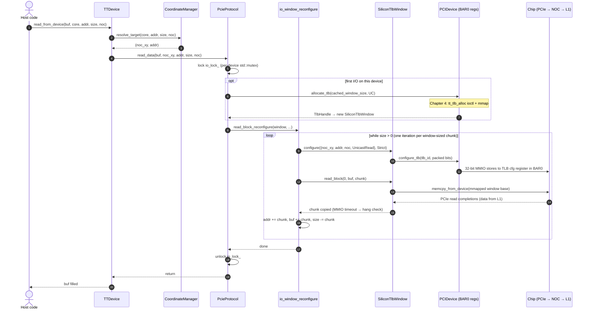
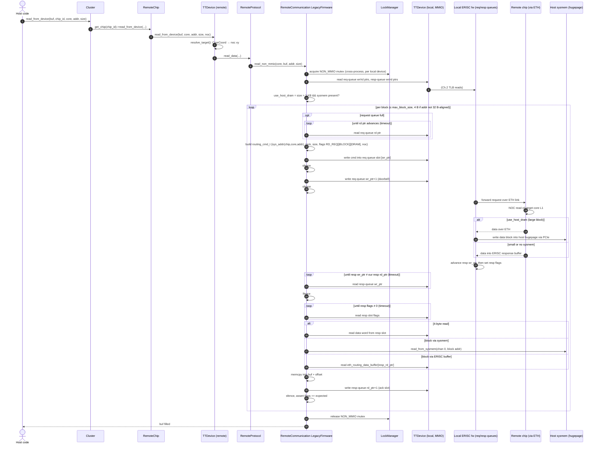

# UMD Transaction Sequence Diagrams

A guided tour of what happens inside tt-umd, one transaction at a time, from the simplest
register poke to multi-chip cluster bring-up. Each chapter is one sequence diagram plus short
notes and links into the code. Read in order: later chapters reuse earlier ones as single arrows.

Source analysed: `tt-umd` @ `519b8eb` (cloned to `../tt-umd`).

## The stack in one picture

```
 tt-metal / user code
        │
 ┌──────▼───────────────────────────── tt-umd-workload ──┐
 │ Cluster  ──►  Chip (LocalChip | RemoteChip | Sim...)  │  multi-chip view, chip IDs, start/stop
 └──────┬────────────────────────────────────────────────┘
 ┌──────▼──────────────────────────────────── tt-umd ────┐
 │ TTDevice           coord translation, ARC, firmware   │  one physical chip
 │   └─ DeviceProtocol  PcieProtocol | RemoteProtocol |  │  "how bytes get there"
 │                      JtagProtocol | Kmd/Sim...        │
 │        └─ IoWindow / SiliconTlbWindow / TlbHandle     │  sliding MMIO window onto the NOC
 │             └─ PCIDevice   BAR0 mmap, TLB cfg regs    │
 └──────┬────────────────────────────────────────────────┘
 ┌──────▼──── tt-kmd-lib ─┐   ┌──── kernel ────────────┐
 │ tt_tlb_alloc/free, ... ├──►│ tenstorrent KMD (ioctl)│
 └────────────────────────┘   └────────────────────────┘
```

---

## Curriculum (proposed)

| # | Level | Transaction | Key code |
|---|-------|-------------|----------|
| 1 | ★ | `bar_read32` / `bar_write32` – raw BAR0 access, no NOC | `pcie_protocol.cpp` |
| 2 | ★ | **Single-chip L1 read over PCIe TLB window** (example below) | `tt_device.cpp`, `pcie_protocol.cpp`, `silicon_tlb_window.cpp` |
| 3 | ★ | Register read/write (`read_from_device_reg`) – width-checked, no chunking | `io_window_reconfigure.cpp` |
| 4 | ★★ | TLB lifecycle: `allocate_tlb` → KMD ioctl → mmap → configure → free | `silicon_tlb_handle.cpp`, `tt_kmd_lib.c` |
| 5 | ★★ | Large write chunked across window reconfigs; multicast write to a core range | `io_window_reconfigure.cpp` |
| 6 | ★★ | Coordinate resolution: logical/translated `CoreCoord` → NOC xy (`resolve_target`) | `coordinate_manager.cpp` |
| 7 | ★★ | ARC message (e.g. set power state BUSY, get clock) – WH vs BH message queue | `*_device_firmware.cpp`, `blackhole_arc_message_queue.cpp` |
| 8 | ★★ | Telemetry read (temperature, board id) | `arc_telemetry_reader.cpp` |
| 9 | ★★ | PCIe DMA read/write (host ↔ device) and the PCIE_DMA lock | `pcie_protocol.cpp`, `pcie_dma/*` |
| 10 | ★★★ | Sysmem: hugepage / IOMMU buffer mapping, device writes into host memory | `silicon_sysmem_manager.cpp`, `sysmem_buffer.cpp` |
| 11 | ★★★ | `TTDevice::create` + `init_tt_device` – open PCI device, detect arch, wait for ARC/DRAM/ETH training | `tt_device.cpp`, `pci_device.cpp` |
| 12 | ★★★ | **Remote (non-MMIO) read over Ethernet** (example below) | `remote_communication_legacy_firmware.cpp` |
| 13 | ★★★ | Remote write + `wait_for_non_mmio_flush`; Ethernet broadcast | same + `ethernet_broadcast.cpp` |
| 14 | ★★★ | Cross-process locking: `LockManager`, robust mutexes, KMD mutex | `lock_manager.cpp`, `robust_mutex.cpp`, `docs/LOCKING.md` |
| 15 | ★★★★ | Topology discovery: walk ETH links from MMIO chips, build `ClusterDescriptor` | `topology_discovery*.cpp` |
| 16 | ★★★★ | `Cluster` construction → chips → `start_device` (membars, RISC reset, sysmem) | `cluster.cpp`, `local_chip.cpp` |
| 17 | ★★★★ | RISC core reset/deassert (Tensix, ETH) | `tt_device/reset/*` |
| 18 | ★★★★ | Hang detection: MMIO timeout → hang check → error | `hang_detection/*`, `device_memcpy.cpp` |
| 19 | ★★★★ | Warm reset and reset notification across processes | `warm_reset.cpp` |
| 20 | ★★★★ | Same read on simulation backends (TTSim / RTL sim) – what changes below `DeviceProtocol` | `simulation/*`, `tt_sim_protocol.cpp` |

---

## Chapter 2 (★) – Single-chip L1 read over a PCIe TLB window

**Scenario:** host code calls `TTDevice::read_from_device(buf, core, addr, size)` on a chip that is
directly attached over PCIe.

**The idea:** the host can't address chip memory directly. The chip exposes *TLB windows*: ranges of
BAR space that the host can point at any `(x, y, addr)` on the NOC. UMD keeps one cached window per
device, re-points it before each chunk, and then does a normal `memcpy` from the mmapped BAR.



**Notes**

- No ioctl on the hot path: allocation goes through the KMD once, and after that reconfiguring the
  window is just MMIO stores to TLB config registers in BAR0 (`PCIDevice::configure_tlb`).
- On Blackhole the config register is 96 bits (12 bytes) and is written as three 32-bit stores
  because a 64-bit store to an unaligned UC address raises SIGBUS on aarch64.
- The window is left pointing at the last chunk. Every transfer reconfigures first, so nothing
  relies on its earlier state.
- Wormhole goes through `SiliconTlbWindow::memcpy_from_device` (it aligns to 4-byte words);
  other archs use `umd::memcpy_from_device`.
- `io_lock_` is a thread lock only. Cross-process safety comes from each process owning its own
  KMD-allocated TLB.

Code: `TTDevice::read_from_device` (tt_device.cpp:445) → `PcieProtocol::read_data`
(pcie_protocol.cpp) → `transfer_and_reconfigure` (io_window_reconfigure.cpp) →
`SiliconTlbWindow::read_block_impl` → `PCIDevice::configure_tlb` (pci_device.cpp:892).

---

## Chapter 12 (★★★) – Remote (non-MMIO) chip read over Ethernet

**Scenario:** on a Wormhole multi-chip system (for example N300 or Galaxy) the app reads L1 from a
chip that has **no PCIe link to the host**. The read is tunnelled: the host writes a command into a
queue on an Ethernet core (ERISC) of the *local* chip. ERISC firmware sends it over the ETH link,
the remote chip does the NOC read, and the response comes back into a response queue or into host
sysmem.

Every "write/read ERISC queue" arrow below is a complete **Chapter 2** transaction on the local chip.



**Notes**

- **Two queues, two pointer pairs.** The host is the producer on the request queue and the
  consumer on the response queue. The firmware is the other side of each. Pointers wrap with
  `cmd_buf_ptr_mask`, and "full" compares wr/rd pointers.
- **Ordering:** `sfence` after the command write and again after the doorbell, so the firmware
  never sees the pointer before the command. `lfence` after seeing the response before reading
  flags and data. Firmware writes the response in the order *clear flags → advance wr_ptr →
  write data → set flags*, which is why the host polls twice.
- **Two data paths:** blocks over 1 KB with sysmem configured come back through host DRAM, which
  is much faster than tunnelling them through ERISC L1. Without sysmem UMD logs a one-time
  performance warning.
- **Serialisation:** the NON_MMIO mutex covers *all processes* using this local chip's ETH tunnel,
  so remote I/O is fully serialised per gateway chip.
- Each block costs at least 6 PCIe round trips of polling and pointer traffic, which is why
  remote I/O is slow and why `EthernetBroadcast` (Ch.13) exists.

Code: `RemoteChip::read_from_device` (remote_chip.cpp:97) → `RemoteProtocol::read_data`
(remote_protocol.cpp) → `RemoteCommunicationLegacyFirmware::read_non_mmio`
(remote_communication_legacy_firmware.cpp:116).
